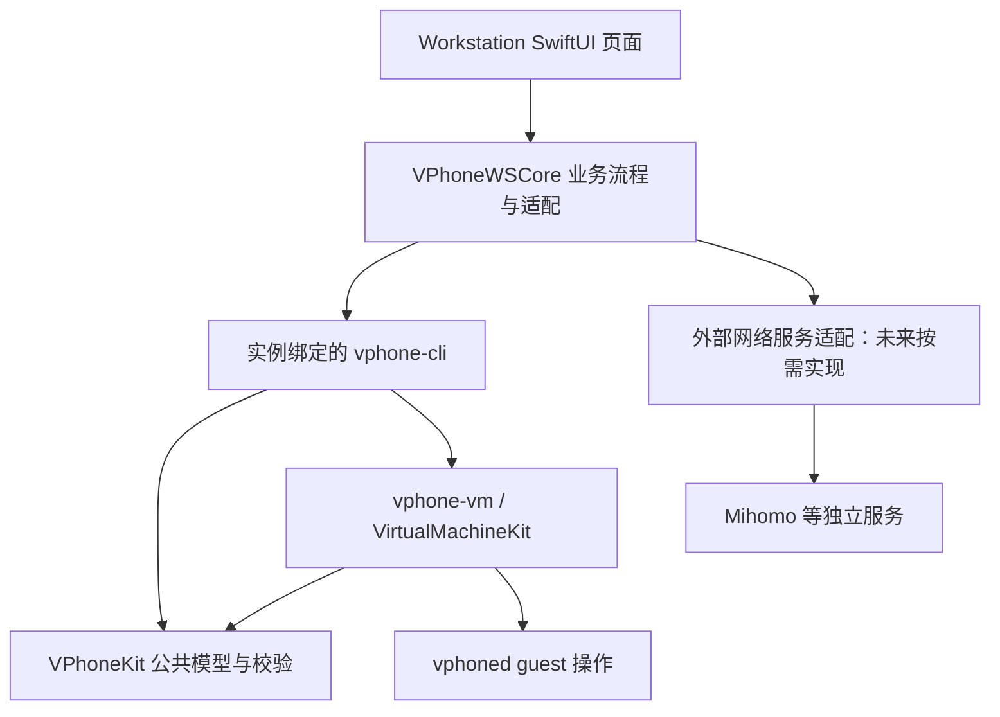

# GUI、CLI 与公共能力的维护边界

2026-10-17：适用于 `tb_dev` monorepo。本文规定维护边界；已实现能力见下方现状表。构建、双上游同步见 [共同开发指南](monorepo-development.md)。

## 分层决策

用户通过 GUI 完成业务操作；CLI 提供可独立执行、可验证的实例能力；Core 保存公共模型与规则。CLI 是入口，不是所有实现的堆放处。业务服务也不是 SwiftUI View。



| 职责 | 实现位置 | 边界 |
| --- | --- | --- |
| 表单、中文、选中实例、进度、错误展示 | `VPhoneWorkstation/Sources/vphone-ws/Views` | 不直接写 VM manifest，不执行 shell 或解析进程列表 |
| 批量操作、任务顺序、取消、部分成功、实例与配置关联 | `VPhoneWorkstation/Sources/VPhoneWSCore` | 编排公共操作，不复制恢复、网络校验或安装算法 |
| CLI 参数、退出状态、输出、单次操作入口 | `VPhoneExecutable/VPhoneCommand` | 不依赖 Workstation，不知道 UI 页面、地区标签或业务账号 |
| manifest、网络配置校验与规划等公共逻辑 | `VPhoneKit/VPhoneCoreKit` 等现有 kit | 权威规则在此，GUI 表单校验仅改善体验，不能替代底层校验 |
| 虚拟网卡、用户态转发、VM 生命周期与 guest 通信 | `VPhoneVirtualization`、`VPhoneKit`、`VPhoneDaemon` 的现有模块 | 私有虚拟化能力不进入管理 GUI；按现有所有权实现 |
| 第三方代理服务 API、配置格式转换 | 优先作为 `VPhoneWSCore` 内独立服务/适配文件 | 不放 View，不把供应商字段塞入通用 VM manifest；有第二个真实调用方再提取共享模块 |

`VPhoneLaunchpad` 是统一主入口，Workstation 保留为备用。Launchpad 通过现有 Swift package 的 `VPhoneWSCore` library 复用代理业务服务；原生界面只负责表单和动作入口，不复制供应商/Clash 逻辑。Launchpad 按 launchpad.json 解析实例上下文，Workstation 保持原 sidecar；共享服务检查资料库中的运行路径隔离。VM 屏幕窗口及其 guest 菜单仍由 `VPhoneVirtualMachineKit` 管理；管理 GUI 并不意味着搬迁所有现有窗口。

## VPN：按能力拆分，不按“有没有界面”拆分

- **GUI 页面**：选择实例、网络方案和出口，展示期望配置、实际配置、检测结果以及需要重启的状态。
- **Workstation 业务服务**：决定哪个实例使用哪个方案，协调 CLI 配置、外部服务更新、验证和失败恢复。批量操作逐实例报告结果，不能一个成功就显示全部成功。
- **CLI/Core**：实现与供应商无关的网络模式、IP/DNS、端口转发、配置读取/校验/保存；同样的动作应能脱离 GUI 执行。优先扩展现有 `vm config`/`vm info`，不要另建重复配置文件或任意 shell 执行接口。
- **外部服务适配**：对接 Mihomo 的控制接口和持久化配置所有者；订阅覆盖、规则排序、策略组等属于供应商适配。控制接口运行态更新不能自动当作重启后持久化成功。
- **VM/guest**：实际网卡和数据传输沿用现有实现。若以后明确要求 iOS 内部 VPN，需另行定义 guest 能力与授权，不能拿宿主代理配置冒充 guest VPN。

`tunnel` 是把 guest 流量转为宿主 socket 的网络模式，不等于加密 VPN。当前 `VPhoneUserspaceNetwork` 已有 TCP/UDP 转发；`VPhoneNetworking` 已有统一配置规划和校验。不要在 GUI 再实现一套网络栈。

本机现有分流依赖实例固定 runtime 的 `vphone-vm` 路径和外部进程路径规则（部署记录见 [分支与运行规范](../../Research/branch_workflow.md)）。更新、移动或共用 runtime 可能改变分流匹配；新 ECID、实例改名均不能替代出口验证。不得为满足路径规则自动复制整套镜像或 runtime。

未来 VPN 功能的最小闭环：读取实际配置 → 用户选择 → 校验目标实例与绑定宿主 → 执行必要的配置变更 → 重新读取配置和外部服务状态 → 从目标 guest 验证实际出口。配置保存、服务可用、出口验证应分别显示；Mac 自身出口测试不能证明 guest 出口。仅有公网 IP 检测不能证明所有 DNS/UDP 或 IPv6 都已按要求路由。

出现失败时保留原配置和具体失败步骤；恢复只涉及本次改动且未被其他进程修改的字段，不能覆盖用户整个 Clash 配置。令牌使用系统凭据存储，不进入 Git、日志、命令行或 VM 导出。接口与持久化方式必须按实际安装版本核验，不能仅依赖最新文档。

官方参考：[Mihomo 配置样例](https://github.com/MetaCubeX/mihomo/blob/Meta/docs/config.yaml)（本次经 GitHub MCP 读取，包含控制接口、进程路径规则和 TUN 配置；不代表本机版本支持其全部选项）。

## GUI ↔ CLI 契约

1. 每个实例操作显式解析真实实例目录、library root 和绑定的完整 bundle；启动、配置、停止、导出应使用同一实例上下文。禁止仅启动使用 pinned CLI，其余写操作悄悄使用全局默认 CLI。
2. 复用现有 `VPhoneCLIClient`、`ProcessLauncher` 和命令构建器。通过 argv 传参，不拼接 shell；解析已有 JSON 输出，不把本地化日志当协议。
3. 新增机器可读接口时明确字段、错误、退出状态、超时/取消和幂等行为，并一起更新调用端与契约测试。本文不宣称现有 CLI 已有统一 capabilities 或任务协议。
4. 独立发布的旧 bundle 不会随 monorepo 提交自动升级。按实际版本/接口选择适配；未知能力应清楚拒绝，不能试错执行破坏性命令。涉及 Launchpad 所依赖接口继续遵守根 AGENTS 的版本系列兼容规则。
5. UI 状态不是运行事实。停止完成与允许导出必须依据实际停止、磁盘释放；CLI 的配置和导出也要维护自身约束，不能只依赖按钮禁用。
6. 权限保持原有窄接口：不把 escalator 或 helper 扩展为任意 root 命令服务。构建、测试、索引不等于部署或更改现有实例。

## 已有差距与迁移顺序

以下是源码检查结论；网络首期实现及接口见 [网络状态与出口检测](workstation-network.md)：

| 当前事实 | 后续处理 |
| --- | --- |
| 已统一 `VMCommandContext`：单实例命令、启动与导出使用绑定宿主和真实目录 | 后续新增操作复用此入口，不绕过绑定 |
| 新版分离式宿主走绑定 CLI 的 stop；旧版保留按 config 定位进程的兼容路径 | 两者都等待磁盘释放；后续逐步退役旧版，不把兼容逻辑复制到页面 |
| Workstation 创建向导仍有旧版参数 | 先完成 2.x 创建流程适配，不把旧 variant 自动映射到新 preset |
| GUI 已增加网络状态、guest 出口检测、每实例 Clash 节点选择及手动录入已购 HTTP(S)/SOCKS5 代理；`VPhoneWSCore/Proxy` 管理规则、代理扩展与 HTTP 接口 | 复用既有独立运行路径和订阅前置规则。CLI 不引入 Clash 配置知识；尚未实现自动采购/续租、VPN 协议管理或断线阻断，不把本功能称为完整 VPN |

证据入口：`LaunchCoordinator`、`VPhoneCLIClient.setConfig`、`VPhoneNetworking`、`VPhoneNetworkEdit`、`VPhoneUserspaceNetwork`。CodeGraph 的静态关系不能证明跨进程 argv/JSON 契约正确，需结合命令入口和测试。

## 开发与验证规范

- 开始前核对现有改动和运行版本，先查 CodeGraph，再读未覆盖的源码；优先迭代现有模块。需求描述先写清用户操作、权威数据、执行归属与失败结果。
- 新底层能力必须能独立测试；GUI 流程测试验证目标、参数、结果与错误，禁止测试只重复实现。网络变更覆盖非法配置、两个实例隔离、服务不可用及保存/生效不一致。
- `scripts/dev.sh test gui` 验证 Workstation；`scripts/dev.sh test cli` 仅覆盖 CoreKit，CLI 命令或 guest 改动还需其所属测试。修改可交付组件后运行相应 build；纯规范修改不启动 VM、不重复完整构建。
- 需要真实双机验收时验证同时启动、单独停止、窗口切换、停机导出；网络变更另测目标 guest 的出口，保留失败证据，不能以 mock 替代真实验收。
- VM、固件、运行配置、密钥、构建缓存和 CodeGraph 数据库不提交。临时产物复用已忽略目录，不能默认新建整机备份。仅清理本次可重建且无进程使用的临时产物。
- 统一在 `tb_dev` 提交；CLI 与 GUI 分别沿既有上游同步路径维护。跨层功能在同一提交/PR 说明契约与兼容性；不要顺带提交他人或此前未完成的改动。

## CodeGraph 使用

仓库根已初始化；本次 `codegraph init` 确认已有索引，`codegraph sync` 完成增量同步，`status` 显示 850 个文件、20,837 个节点、53,057 条边，已能定位 `VPhoneWorkstation/` 与 native kit。数字仅为本次快照。

```sh
codegraph status
codegraph explore "LaunchCoordinator VPhoneCLIClient"
codegraph explore "VPhoneNetworking VPhoneUserspaceNetwork"
codegraph node VPhoneWorkstation/Sources/VPhoneWSCore/Lifecycle/LaunchCoordinator.swift
```

首次新 checkout 在根目录运行 `codegraph init`；源码或布局变化后按需 `codegraph sync`。只有索引失效且增量不能修复时才完整 `codegraph index`，不要每次任务重建或为子目录再建一套索引。数据库留在已忽略的 `.codegraph/`；索引辅助定位，不是架构强制检查器。本次规范没有新增 CI 依赖规则或自动拦截。
