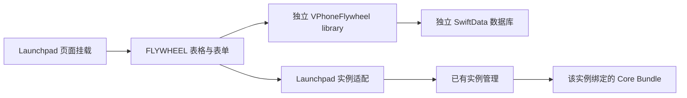

# FLYWHEEL 与 Launchpad 接入边界

2026-10-22：Launchpad 增加 FLYWHEEL 业务入口，点击打开独立业务窗口，平台主页面保持不变。重复点击唤起已有窗口；业务窗口关闭不关闭主窗口，“平台管理”唤起主窗口并选中对应实例。首期提供本地虚拟机业务登记、查询、编辑和删除。FLYWHEEL 后端 API、远端同步和任务下发尚未接入。

## 工程关联

| 工程 | 本机源码位置 | 职责 |
| --- | --- | --- |
| vphone-cli | `/Users/tubao/code/github/vphone-cli` | Launchpad 管理界面、本地业务设备与虚拟化能力 |
| FLYWHEEL | `/Users/tubao/code/private/flywheel/JeecgBoot_flywheel` | 后续业务 API、业务权限和远端数据 |

FLYWHEEL 的反向入口是 [项目关联说明](/Users/tubao/code/private/flywheel/JeecgBoot_flywheel/docs/flywheel/vphone-launchpad-integration.md)。本页维护客户端隔离与升级边界；后端合同由 FLYWHEEL 工程维护，不在两个仓库复制接口定义正文。

绝对路径只帮助本机定位源码，不作为构建或运行依赖。两个仓库独立维护，Launchpad 构建及本地业务管理均不要求存在 FLYWHEEL 源码或远端服务。

## 功能合同

在 Launchpad 工具栏点击 **FLYWHEEL** 进入虚拟机管理，再通过 **平台虚拟机** 返回原页面。

| 字段或操作 | 行为 |
| --- | --- |
| 设备编号 | 用户定义的纯 ASCII 数字，全业务库唯一；移除前导零，`001` 与 `1` 是同一编号；支持 `0`，不受整数长度限制 |
| 名称 | 从选中的平台实例读取，不在业务表单中改名 |
| 地区 | 可选国家或地区代码，如 `US`；仅业务分类，不修改代理出口或 guest 位置 |
| 备注 | 独立业务文本 |
| 新增关联 | 选择已有平台虚拟机并登记业务编号；同一实例只能有一条业务记录 |
| 查询与编辑 | 按编号、名称、地区、备注或资料库路径查找；原生表单保存或取消 |
| 启动与关闭 | 直接调用现有 Launchpad 实例方法，复用状态判断、preflight 与绑定 bundle |
| 更多中的平台管理 | 返回原虚拟机页面并选中目标实例，可继续使用配置、代理等已有功能 |
| 删除业务记录 | 确认后仅删除业务编号、地区、备注和关联；不停止或删除 VM，不处理磁盘 |

表格使用原生 SwiftUI `Table`，列宽可拖动调整；编辑使用 grouped `Form` 与 sheet。编号按数值大小排列，表单草稿在保存前不触碰持久化模型。

实例定位保存资料库、名称、UDID 和本机目录身份（文件系统设备号、inode、创建时间）。同一资料库内目录身份唯一且一致时同步改名；不以 UDID 推断改名，因为普通克隆会保留 UDID。目录身份只存独立业务库，不写入 VM 配置。目录复制、删除重建、跨卷迁移后需显式关联；缺少文件系统元数据时禁用操作，不降级到名称匹配。目录身份不是跨主机全局 ID。旧记录没有目录身份，显示“需确认关联”，用户在编辑表单中重新选择实际实例后保存；不自动认领同名替换。新身份克隆首次启动生成 UDID 时，在目录身份一致的前提下补齐原先缺失的 UDID。

平台列表读取失败时显示“状态未知”，不根据旧列表执行启停或新增关联；仍可维护已有业务记录。业务数据库打不开时仅业务页面报错并提供重试，平台管理继续可用，不自动删除损坏数据库。

## 持久化选择

本次检索 Launchpad、Workstation、宿主 CLI 与共享 Swift kit，没有找到可复用的 SQLite/GRDB、Core Data 或 SwiftData 业务数据层。现有 `VPhoneLaunchpadMachineBinding` 和 Bundle store 用 JSON 保存配置，资料库列表等偏好使用 `UserDefaults`；这些配置不适合直接承载独立业务 CRUD。

| 方案 | 当前适用性 |
| --- | --- |
| 现有 JSON / UserDefaults | 继续保存平台配置与少量偏好；若承载业务表，需要自行维护查询、唯一性与事务 |
| Apple SwiftData | 本次采用；macOS 15 项目可直接使用，原生模型与持久化，无第三方包依赖 |
| Core Data 或 SQLite 开源封装 | 当需要更细的数据库控制或现有模型兼容时再评估；当前单表 CRUD 不额外引入 |

通过 MCP 核对的 Apple 文档支持显式配置存储 URL，并用 `.none` 关闭 CloudKit 同步，见 [ModelConfiguration](https://developer.apple.com/documentation/swiftdata/modelconfiguration/init(_:schema:url:allowssave:cloudkitdatabase:))。本次磁盘测试确认生成的存储文件为 SQLite。

默认数据位置为：

```text
~/Library/Application Support/vphone-launchpad/Flywheel/devices.store
```

数据库独立于 VM 目录和 `launchpad.json`。SwiftData 模型保持内部可见，业务库统一验证编号、地区、唯一实例关联后显式 `save`；禁用 autosave，保存失败执行 rollback。数据库模型变更后应提供兼容迁移并验证已有数据，不通过删库恢复启动。

这是当前 Mac 用户的本地业务库，不代表已同步到 FLYWHEEL 后端。备份时先退出 Launchpad，再复制整个 `Flywheel` 目录，包含 SQLite 的相关文件，不只复制运行中的 `devices.store`。测试用显式临时 URL，不读取正式数据。将来接入 DEV/TEST/INTL 后，须按实际合同隔离远端凭据和关联，不能把当前本地数据默认上报到某个环境。

## 代码与依赖边界

| 内容 | 位置 | 依赖 |
| --- | --- | --- |
| 业务值类型、校验、SwiftData 存储与测试 | `Integrations/Flywheel/`，产品 `VPhoneFlywheel` | Foundation、Observation、SwiftData；不依赖宿主内部类型或 UI |
| 原生表格、表单与实例操作适配 | `VPhoneLaunchpad/VPhoneLaunchpad/Flywheel/` | 业务库与现有 Launchpad 实例管理 |
| 业务入口 | `VPhoneLaunchpadRootView.swift` | 通过原生 openWindow 打开或唤起业务窗口，保留平台页 |
| 窗口注册 | `VPhoneLaunchpadApp.swift` | 注册单实例 SwiftUI Window；启动时不自动打开业务窗口 |
| 窗口适配 | `Flywheel/VPhoneLaunchpadFlywheelWindow.swift` | 共享现有平台模型；“平台管理”打开主窗口并定位实例 |
| 本地 library 引用 | `VPhoneLaunchpad.xcodeproj/project.pbxproj` | 仅主 App 链接业务库，helper/CLI/launcher 不链接 |
| VM 生命周期与 guest 操作 | 原有 Launchpad/CLI/Core | 不依赖 FLYWHEEL |



业务库没有 SwiftUI 或 Launchpad 依赖，不访问 VM 文件或执行进程。宿主适配层调用 `VPhoneLaunchpadMachineLibrary.start/stop`，每次操作核对当前平台实例；不复制 CLI 参数、shell、preflight 或实例启停逻辑。业务库位于 Workstation subtree 之外，已有代理模块保持原归属。

## 构建与升级验收

### 业务网络准备与登记前检查（2026-10-22）

平台详情的 FLYWHEEL 区域显示网络检查结果，并提供“检查网络”与“准备网络与出口…”。
业务表格增加“业务网络”列，“更多”菜单可检查或准备关联实例。
未运行、实际 NAT、无网络设备、链路 down、DECODO 路径不可确认和 guest 检测失败
分别显示具体原因。检查结果标注时间；点击业务网页始终重新读取实际出口，不以旧结果替代。

“准备并验证”只操作所选实例。绑定核心需支持 tunnel；NAT/其它模式先正常停止再修改，
已运行的 tunnel 实例不重启。复用已验证的 DECODO 路径，否则使用现有
`NativeDecodoController` 为该实例建立原生 ISP 出口，核对入口与 guest 实测 IP 一致后完成。
原生代理沿用核心已有的私有配置文件与引用机制，不新增供应商 manifest 字段。
未支持原生代理的核心显示具体能力缺失，可先通过原代理页面配置 Clash / DECODO 后重试。
不自动升级核心，不修改全局 Clash 或其它实例出口。

准备表单明确展示新出口城市、物理 Wi-Fi 网卡和本机代理凭据文件。
三个偏好以 `flywheel.decodo.city/device/credentialsPath` 独立保存；密码仍由已有服务从
0600 本机文件读取，不复制到业务数据库或偏好。默认 New York/en1 与现有原生代理表单一致，
执行时验证物理网卡；用户可选择已有有效代理配置文件复用账号。

FLYWHEEL 的“新增关联”（新增业务设备）及更换关联实例，保存前自动执行上述准备，
只有 guest 出口验证通过才保存业务记录。编号/地区先校验；失败保留表单供重试，
已完成的网络步骤无需重建 VM。仅修改原记录的编号、地区、备注不强迫停机或重新配网。
这里登记已有平台 VM；平台新建/恢复流程和基础 NAT 默认值不变。
所有实例操作在原 library、目录身份、pinned bundle 下执行；检测和打开网页共用相同适配器，
每次请求前后重新核对身份与核心。业务网络准备和网页打开互斥。

业务数据 schema 无变化；网络准备只通过已有通用配置接口修改目标网络模式。
独立业务模块测试覆盖 NAT 停/开机、已有 tunnel、阶段失败、取消及验证顺序，
宿主测试覆盖 NAT/无网卡/断链/非 DECODO 的具体提示，以及只读检查不会打开 Safari。

2026-10-23 部署与真实验收：

- 36 项业务/生命周期测试、宿主实际适配器测试、完整 Launchpad 构建及 strict/deep 签名验证通过。
  宿主测试还覆盖旧表单持有 NAT 快照时，重试必须读取刷新后的 tunnel 配置而不重复停机。
- `init-check-01` 通过真实 Launchpad“准备并验证”改为 tunnel 并接入原生 DECODO。
  复用原有已购 ISP 账号，为现有服务提供 0600 的本机凭据文件；没有购买账号或修改 Clash。
  原 `config.plist` 对比只改变 `networkConfig.mode`，
  MAC、硬件、身份和核心绑定保留，其它四台配置与代理文件校验一致。
- 首次冷启动暴露 guest 控制连接早于 DHCP/网络路径就绪；现等待链路 up 与 guest IPv4，
  新应用代理时保持同一入口等待路径建立，最终出口验证最多三次，取消不重试。
  网络错误不会被当作就绪，也不会通过反复轮换出口掩盖失败。
- 最终新版进程冷启动检查通过，`isp.decodo.com:45926`、guest IP `72.245.68.175`；
  入口引用在重启后保留。通过网页按钮打开用户已配置的测试地址，自动附加该 `ip`；
  Launchpad 返回 Safari 请求成功，guest `apps.foreground` 确认 `com.apple.mobilesafari`、verified=true。
  已看到该站的 JeecgBoot 加载页面；没有登录或提交网页业务，完整网页业务由用户验收。
- 真实 FLYWHEEL 窗口显示“业务网络”列；新增关联草稿选中实际实例后，确认保存前准备说明、
  城市/网卡/凭据来源与已测 IP 正常显示，然后取消，没有为测试创建正式业务记录。
  原有历史关联及业务字段保留，不将已失效的旧关联自动绑定到别的 VM。
- 部署保留安装包的 Helper/CLI/VM launcher，主程序和 Debug dylib 一起更新。
  准备表单打开时退出快捷键可能不结束旧进程；部署核对必须关闭表单、正常退出并用 PID 确认，
  不能仅验磁盘文件就声称新进程已运行。最终已核对新 PID 与安装文件签名。

备份位于 `~/.vphone/deployment-backups/flywheel-network-20261022-233921/`，
测试与 guest 取证位于仓库忽略目录 `.build/validation/flywheel-network-20261022/`。
最终只保持 `init-check-01` 运行供用户继续验收，其余四台保持停止。
业务数据库结构无变更，无需后端、Online 元数据或数据库同步。

### FLYWHEEL 业务网页快捷操作（2026-10-22）

平台虚拟机详情页的 **FLYWHEEL** 区域提供“业务网页 URL”和“打开业务网页”。
URL 在当前 Mac 用户的 Launchpad 偏好中自动保存，键为 `flywheel.businessWebURL`，
所有实例共用。默认留空；不预设业务环境、不访问后端，也不要求先登记业务设备。
URL 下方的参数行提供 `ip` 复选框与最近检测值，默认勾选；勾选状态使用独立的
`flywheel.businessWebIncludeIP` 偏好保存，所有实例共用。取消勾选时移除 URL 中所有 `ip`
查询项，保留其它参数与 fragment；仍按以下流程检查业务网络，成功后聚焦对应虚拟机。
自定义参数支持新增、删除、启用与编辑名称/值，每次编辑自动保存到独立的
`flywheel.businessWebParameters` JSON 偏好，由 `VPhoneFlywheelURLParameterStore` 持有；
不迁移业务数据库、不更改旧 URL 和 ip 偏好。参数行用稳定 UUID 标识，重复名称保持行顺序，
允许空值；空白草稿忽略，启用且有值却无名称时在请求前报错。自定义名称去除首尾空白，
值保持原样。`ip` 为保留名称，只使用自动行，不能用自定义行覆盖。
列表出现的名称覆盖原 URL 的全部同名查询项，未启用的行不发送；未在列表管理的原参数与
fragment 保留。删除自定义行后该名称不再由列表管理；原 URL 若已有该参数，恢复以原 URL 为准。
自定义参数经 URLComponents 编码，文字中的加号另编码为 `%2B`，避免表单式服务端误读为空格。
偏好读取失败或行标识重复时保留原数据，显示具体错误并禁用打开入口，不以空参数静默继续。
2026-10-23 自定义参数已部署至本机安装版。45 项业务测试、宿主适配回归和完整构建通过；
真实界面验收了多行新增、名称/值再次修改、未离开编辑框即保存、取消发送和依次删除全部测试行，
并从偏好重新读取逐项核对。带中文、加号和 & 的选中参数在 `init-check-01` 收到 Safari 打开确认，
guest 前台 Safari verified=true。测试行已删除，原 URL 和 ip 勾选状态保留；五台配置与绑定、
目标原生代理引用摘要一致，业务记录与一致性备份相同。冷启动首次检测超时，独立重试后恢复原
出口 `72.245.68.175`，没有轮换代理；自动聚焦仍遵循上述 macOS 前台策略。
2026-10-23 参数选择已部署并在 `init-check-01` 实测：勾选和取消均收到 Safari 成功结果，
取消时显示“未附加 ip 参数”，guest 前台为已验证的 Safari。38 项业务测试、宿主适配测试与
完整构建通过；测试覆盖重复参数清除、其它参数保留、选择持久化及取消后仍聚焦正确实例。
验收后保留取消勾选状态，原 VM 配置、绑定、原生代理引用与部署前摘要一致，业务记录无变化。
仅接受无内嵌账号密码的 HTTP(S) 地址，拒绝飞书域名。配置目标应为已知的业务网页；
此校验不宣称能够控制 Safari 后续的网页重定向。

执行顺序：

1. 核对当前实例仍在运行、列表有效、目录身份与 pinned bundle 未变化。
2. 通过该实例的 `vphone.sock` 读取实际网络状态，要求 tunnel 且链路 up。
   原生代理读取实际 `native_proxy_endpoint`；Clash 复用既有服务核对持久化与生效规则、
   TUN、rule/strict 模式及独立运行路径。入口必须为 `isp.decodo.com` 或 `gate.decodo.com`。
3. 调用现有 guest `network.egress`，只接受 `origin=guest` 的 IPv4；不用 Mac 或缓存 IP 代替。
4. 再次核对实例、核心和出口路径；按本次点击时的参数快照合成 URL。勾选时替换所有已有 `ip` 为本次值，未勾选时移除 `ip`；自定义参数按上述规则合并。
5. 调用 `apps.open_url`，明确传 `bundle_id=com.apple.mobilesafari`，核对返回 URL 与 bundle ID。

请求期间禁用重复点击和详情页的代理切换入口。选中另一实例不改变已开始任务的目标；
停止、改名、同名替换或核心绑定变化会令后续步骤失败。失败只重试本业务动作，
不换 IP、不切回直连、不停止或重建 VM。旧核心缺能力时仅该动作报错。
成功文字表示 Safari 打开请求返回成功，不表示网页加载完成或服务端业务成功。
Safari 返回成功后，Launchpad 自动将该实例的虚拟机窗口切到前台。通过该实例控制 socket
的拥有者 PID 和 pinned bundle 的 `vphone-vm` 路径核对目标，避免同名或相同 UDID 实例串机；
切换前再次核对目录身份和绑定。打开失败不切换窗口，切换失败单独提示并保留 Safari 成功结果。
遵循 macOS 的协作式窗口激活：若等待时用户切到其它应用，系统可能拒绝转移焦点并显示上述提示。
2026-10-23 已构建并部署至本机安装版；宿主回归覆盖成功后聚焦、同名跨库目标隔离、失败不聚焦及
窗口激活失败不覆盖 Safari 成功结果。真实 `init-check-01` 的 Safari 前台 RPC 验证通过，
用户在 Launchpad 保持前台点击后，确认已自动切换到该虚拟机。现有配置、绑定与原生代理引用校验一致，
业务记录与部署前一致性备份逐项比较无变化。
IP 是检测时的快照，外部切网与供应商轮换仍可能影响后续请求；需要严格一致时由目标服务核对真实来源 IP。

通用 guest 能力保持原归属；URL、DECODO 前置条件与流程在 `Integrations/Flywheel/`，
宿主适配及 UI 位于 Launchpad 的 `Flywheel/`。上游接入只有详情页的一处组合与
复用代理服务的可见性调整。移除该 Section 后原有平台能力照常工作，
不更改 VM manifest、`launchpad.json`、helper、CLI/guest 合同或 Core Bundle 版本系列。
没有 SwiftData schema、后端数据库、Online 元数据或远端配置同步。

业务测试覆盖 URL 编码、参数替换、非法目标/出口、guest 来源、出口变化、独立重试、
能力缺失、取消和 Safari RPC 合同；原有生命周期矩阵继续回归。
宿主适配测试编译实际 adapter 和构建出的业务/代理包，仅替换 App 模型与传输边界，
使用临时目录测试同名同 UDID 的跨库隔离、重复点击、停机、列表错误、绑定变化和目录替换。

```sh
swift test --package-path Integrations/Flywheel
# 完成下面的 Launchpad 构建后：
zsh VPhoneLaunchpad/Tests/FlywheelWebActionTests.sh
```

本次完整 Launchpad 构建、29 项业务/生命周期测试和宿主适配测试通过。
2026-10-22 经用户授权维护窗口后，正常停止 `init-check-01`，部署到
`/Applications/vphone-launchpad.app`。采用先前通过构建和测试的主程序与 Debug dylib，
保留已安装包的 2.10.0 版本信息、Apple Development 签名团队、Helper、CLI 和 VM launcher，
没有安装或切换任何 Core Bundle。主程序及 dylib 一并更新，签名通过 strict/deep 验证。
已在真实应用的虚拟机详情页目视确认 URL 输入框与“打开业务网页”按钮。

原 App、FLYWHEEL 数据目录、偏好和部署前后校验记录保存在
`~/.vphone/deployment-backups/flywheel-web-20261022-225157/`。
重启管理 App 后五台实例的配置、核心绑定、Clash 配置与 FLYWHEEL 数据文件校验一致；
全部实例保持停止，没有重新启动。数据库结构无变更，无需同步。
业务 URL 留空由用户配置；真实 guest Safari 和服务端接收参数仍由用户验收。

从仓库根运行：

```sh
swift test --package-path Integrations/Flywheel
xcodebuild -project VPhoneLaunchpad/VPhoneLaunchpad.xcodeproj \
  -scheme VPhoneLaunchpad -configuration Debug \
  -destination 'platform=macOS,arch=arm64' \
  -derivedDataPath .build/FlywheelLaunchpad -jobs 4 build
```

CLI 上游仍从 `upstream/main` 合并，Workstation 仍按 [双上游流程](monorepo-development.md) 同步。业务主体集中在独立 package 和新建的 `Flywheel/` UI 目录；现有上游源码接入点只有 root view 和 Xcode package 引用。升级时先检查这些挂载点及 `MachineLibrary`、`MachinePath`、`Machine` 的接口，再运行业务库测试和 Launchpad 构建，不承诺零冲突。

持久化测试覆盖磁盘重开 CRUD、编号与关联唯一性、同名跨库隔离、身份变化、显式重新关联、查询、失败校验不改数据、独立数据文件与损坏库不重置。UI 渲染测试只使用临时测试数据；不能把静态渲染或构建通过描述为真实虚拟机启停验收。

本功能不修改 bundle 合同、VM manifest、固件、guest 或 privileged helper，也不替换已安装 App 与 pinned runtime。源码构建与部署分开；后续远端业务接入继续读取双方 `AGENTS.md`，FLYWHEEL INTL 只读约束仍有效。

## 生命周期变更的开发与验收规范

所有影响平台列表、名称、定位、持久化和业务操作的变更，都必须运行 `swift test --package-path Integrations/Flywheel`，并通过 Launchpad 构建。关联校验只能在独立业务库及宿主适配层实现，不能向平台配置写业务 ID。表格、查询、编辑、启停和平台跳转必须使用同一份经过校验的关联；实际执行前重新核对目录身份。

| 场景 | 必须保持的行为 |
| --- | --- |
| 同目录改名、连续改名 | 更新名称、搜索和操作路径；保留业务 UUID、编号、地区、备注 |
| 平台删除 | 保留业务记录，显示需重新关联，禁用启停和跳转；不得静默删除业务信息 |
| 普通克隆（相同 UDID） | 不生成或复制业务记录；原关联仍指原目录 |
| 克隆后删除源机 | 不把旧业务记录转给剩下的克隆，即使只剩一个相同 UDID |
| 同名同 UDID 替换、恢复副本 | 目录身份不同则拒绝自动关联 |
| 新身份克隆 | 需自行登记独立编号；首次生成 UDID 可在同目录中补齐 |
| 为克隆显式登记后改名、删除 | 只影响其自身关联，不影响源机的编号与备注 |
| 旧数据库升级 | 保留已有字段；缺身份信息时需用户确认，不猜测迁移 |
| 列表错误、路径不可读、跨资料库移动 | 不执行旧定位上的操作，不做模糊回退 |

测试必须覆盖完整事件序列和数据库重开后的状态，不只测试孤立的匹配函数。目录身份测试使用真实临时文件系统；不得删除用户 VM 或复制用户磁盘作为默认回归步骤。新增持久化字段还须在旧数据库副本上验证迁移。自动测试、真实临时文件系统测试、真实 VM 生命周期验收须分别报告，不互相冒充。

部署 Debug 版本时同时核对主程序与 `vphone-launchpad.debug.dylib`，避免只更新加载器。保留当前 Helper、运行时和业务数据库备份，安装后检查真实页面、既有配置校验值与运行进程。

### 2026-10-22 生命周期回归结果

- 发现并修复：普通克隆保留 UDID，删除源机后仅凭唯一 UDID 会把业务关联误转给副本。现改用本机目录身份核对。
- 18 项 Swift 测试通过，包括真实临时目录的复制、删除、重命名、同名替换，业务数据独立登记及数据库重开；没有删除或克隆用户的真实 VM。
- 原业务数据库使用 SQLite backup 制作一致性副本，在副本上完成 SwiftData 可选字段迁移，业务 UUID、编号、名称、地区和备注逐项比较一致。旧记录保持未确认状态，不自动认领实例。
- 完整 Launchpad 构建通过。本次未部署生命周期修复：现场存在并行 Core Bundle 安装操作，保留当前运行应用。不能将上述测试表述为真实 VM 删除/克隆或新版 UI 已验收。
