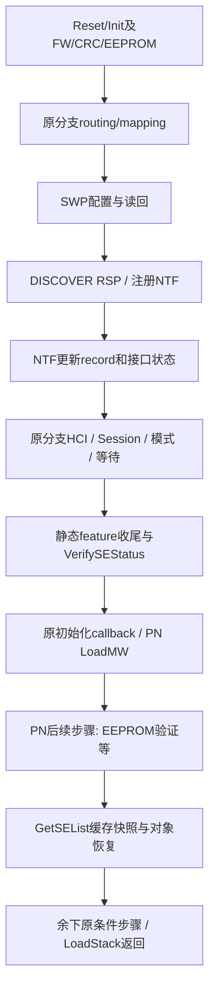

# 23G90 Comet：routing／NFCEE 到 SE 枚举与 LoadStack 完成

2026-10-23。用户本轮已允许后续改系统、绕过门槛及绑卡；本轮请求的主体仍为离线恢复，实际只读现有固件／取证副本，未使用这些运行态授权。未启动／挂载实例、加载或执行 Comet／HAL、运行后端、修改系统／门槛或卡状态。

## 结论

**已把主要控制面接到 NFCEE 记录、Comet SE 状态检查、PN548 缓存枚举和 LoadStack 返回条件；仍缺真实后端执行及部分 HCI／Session／恢复分支，不能称已通过原生 LoadStack 或 eSE 会话。** 本轮最大的收敛是明确了成功判据：discovery RSP、接口配置、SE通知、库初始化callback、PN548枚举和最终LoadStack返回必须分别观察。

三个不能混同的事实：CORE_INIT允许interface count0，但普通mapping分支拒绝它；库会合成NULL-handle的Host条目，列表非空不代表eSE存在；PN548 `isLoaded` 在后续24步之前就可置位，不能用它代替最终成功。

细表：[routing／mapping](comet_routing_mapping_20261023.md)、[SWP／NFCEE命令与通知](comet_nfcee_discovery_20261023.md)、[eSE状态与PN548枚举](comet_ese_power_enumeration_20261023.md)。前轮 [FW／厂商／EEPROM命令表](comet_no_rf_loadstack_commands_20261023.md)、[CRC](pn548_user_frames_crc_20261023.md)、[HAL前端](stockholm_hal_frontend_contract_20261023.md) 继续适用。

## 同版来源与研究边界

Comet仍为本地23G90 IPSW原版提取物：UUID `AAD82B14-9985-3582-9A57-22047E668A31`、source `366.9.1.0.0`、Mach-O SHA-256 `6503712f79f71f304061c8a53b1094afaa62d902ddee2a38b60d48b46a5f3313`。本轮复核该身份，并再次比较此前保留的原DSC六个const/data/authstub区段与重建库，全部相同；没有重新解包大DSC或读取guest Comet作部署比较。

PN548复用此前同版／部署已核对副本及原岛解析的 `pn548-annotated-disass.txt`；不使用已知错误的otool外部stub标签。函数名来自真实日志xref／LC_FUNCTION_STARTS，VA为本版用户态未滑动地址。经MCP搜索并读取 [NXP官方固定版NCI定义](https://github.com/NXPNFCLinux/linux_libnfc-nci/blob/449538e5e106666e5263afeaddacc5836fc23d3f/src/libnfc-nci/hal/include/nci_defs.h)，仅核对标准组号／操作名；私有参数与状态以本版代码为证。

## 无 RF 初始化的实际命令和响应字段

以下线上十六进制包不含可选尾CRC。`L`为Lib context，`N`为NCI context；wire status、Lib接口状态、NCI record状态、PN548对象状态是不同命名空间。

| 阶段 | 实际命令／结构 | 响应／状态变化与条件 |
| --- | --- | --- |
| 默认listen routing | `21 01 len more count TLVs`；四条protocol TLV分别`01 03 00 01 05`、`01 03 c0 01 04`、`01 03 02 01 04`、`01 03 00 01 04` | 单包时payload22B，成功RSP=`41 01 01 00`；容量至少20B及protocol-routing能力。`L+c84∈{0,2}`且前步成功才发，按max control payload分批并维护more／cursor |
| 默认mapping | `21 00 07 02 04 03 02 80 01 80`；count2、每项protocol/mode/interface三字节 | 成功RSP=`41 00 01 00`，精确单字节status；仅`L+c84==0`发送，NCI保存的RF interface count必须非0，否则同步ff且不发包 |
| SWP接口设置 | bb2==0：`20 02 09 02 A0 EC 01 u A0 ED 01 e`；其它：`20 02 05 01 A0 ED 01 e` | 通用SET_CONFIG状态／失败参数解析；u来自`L+1e8` bit0，e来自bit1。此调用不选择A0D4；不是独立SWP vendor opcode |
| SWP／NFCEE接口读回 | bb2==0：`20 03 05 02 A0 EC A0 ED`；其它：`20 03 03 01 A0 ED` | GET的status、count、ID/length/value；count须匹配请求。value0令对应Lib接口状态为2；非零保持默认状态，等待真实NTF更新 |
| NFCEE发现启动 | `22 00 01 01`；停止同发送器action0 | 正常RSP=`42 00 02 status count`；status0保存预期数量`N+f69`，注册NTF后回调；全接口状态2或已启动等原条件可不发 |
| NFCEE discovery通知 | `62 00 len id wireStatus m protocols[m] k TLVs` | 实际通知更新设备表和Lib状态；不等同于RSP的status/count。record与TLV内存需存续到上层使用及移除清理 |
| NFCEE模式 | `22 01 02 ID mode`，mode0/1 | RSP至少须有status；0接受，f1→内部51，其它失败。成功RSP后仍可能等待通知／timer，不能立即视为模式完成 |
| 正常模式完成通知 | 私有`7f 18 len result`（Power OFF）、`7f 20 len ID result`（EoOp） | RSP先置N[1920]=1，通知需匹配pending／请求mode／ID，再取消N+1238 timer、清pending并调用原callback；不是discovery通知 |
| 静态收尾flush | `2f 21 00`，仅原平台分类条件命中时发送 | RSP须精确1B；00及06均被本版parser接受。没命中时只改变本地syntax-retry状态，不发flush |
| 后续Session／HCI | 依当前profile走Session GET、逻辑连接／HCI admin pipe等序列 | 与discovery、mode不同；Session ID全ff会重试或失败。尚不能用上表几条固定RSP替代完整初始化 |

routing属于RF management组的静态配置，本轮这些包没有发起RF_DISCOVER射频轮询。无RF收发器可以缩小模拟范围，仍需履行原分支实际请求的能力与静态配置；不应因组名含RF就删除routing／mapping。

mapping的mode3和私有interface80来自原始数组；原DSC常量`0x2a2fc3708`为`{u32 2,u32 80}`。前轮“INIT独立parser允许n0”仍成立，**仅在实际执行普通mapping时，n0成为后续同步错误**；其他c84模式原本跳过mapping，不能把这个结论扩大为所有产品模式必失败。

## discovery通知的最小完整字段与生命周期

| 字段／阶段 | 当前恢复的约束 |
| --- | --- |
| ID与wire状态 | ID不能为00/ff；wire status0=active、1=inactive、2=removed。eSE connected分支识别IDc0，不能用PN API编号1代替 |
| protocol列表 | m≤5；允许00/APDU、01/HCI、02、03、80；m0可被解析但不声明可用传输协议 |
| 信息TLV | k≤3；已恢复tag00、01、厂商A0路径；逐个T/L/V边界及尾部总长度必须匹配。A0含移除reason分支，不可一概当普通标识 |
| 完整包长 | 至少`4+m`，再按k累计每项2+valueLen；当前parser部分前置bounds检查较弱，不能把短包读取缺口当作协议 |
| NCI设备表 | 五槽`N+f80+i*68`，同ID复用或找空槽；实际数量`N+f68`与RSP预期数量`N+f69`分开。wire active0保存为record+4的u32=1，inactive1保存0 |
| 通知递交 | 成功解析且NCI callback非空才发内部connected/removed事件，携带ID、record指针；内部callback参数不是原始wire包 |
| Lib的eSE记录 | 合适初始化状态下，connected c0使`L+1b8=record`、`L[16e]=1`、`L+1c0=1`，`L+1c4=(record.state!=1)`；removed和恢复另走状态变更 |

StartDiscovery先清理旧NFCEE记录的TLV保存区，再发起新一轮发现；后续生命周期复核已明确这不等于清空ID／count或释放内嵌record／NCI context。上层仍需处理记录重用、重复／移除及旧对象协调。RSP收到count不等于这些记录已齐，也不能把timer到期解释为收到一条成功通知。正常ModeSet完成的私有通知另有匹配条件：EoOp通常核对record ID与mode非0，Power OFF在record为空或mode0路径完成；详细例外见NFCEE报告。正常通知清N+330/338后经Notify读取N+d38/e80的同份callback，timeout则直接使用330/338；结果data byte与callback status必须分开。

## 从MW配置到eSE状态验证与缓存枚举

这是依赖分层图，不代表所有profile都按相同线性报文序列执行；通知、timer和分支可能交错。Comet本身还有监听路由后的reinit，完整原始顺序见初始化表。

InitializeComplete在`0x2a2f55dc0–55dd0`预建Host：`L[16a]=1`，`L+198=NULL`，`L+1a0`两个u32为`{type5,state1}`；原DSC常量`0x2a2fc3710=0500000001000000`已独立复核。这个Host条目不依赖实体eSE句柄。

`StaticListenModeRouting @0x2a2f5bb28`实际选择`0x2b17bc570`表：standby→禁用ESE/UICC/SE2→FlushSramData→staticFeatureCfgComplete。它的名字不能代替指令证据，也不是再发一次`21 01`的别名；逻辑mode禁用与切断物理电源也不能等同。

staticFeatureCfgComplete内联VerifySEStatus检查Lib记录，未直接测量硬件电压。初始化callback存在时，配置F=`u32(L+1e8)`为0可跳过比较；F非零且bit1设时，eSE接口状态s=`L[16e]`为1或2可通过；bit1清时要求s!=1。非初始化场景bit1设则要求s==1。错误依b73选择89或ff并清理；不能把“此软件条件成立”说成已证物理上电。

PN548日志的eSE power-on failed比较API状态`0x43`，最多3次尝试。另已恢复SE mode失败会产生43并交SetSeModeSeqComplete，但**尚未证明这条mode事件到LoadMW初始化callback的完整连接，也没有证据把VerifySEStatus的89自动转换成43**。同值或相似日志不能补出缺失调用链。

GetSecureElementList公开入口`0x2a2f79874`→正常SM event8→`0x2a2f5ef9c`遍历Lib缓存；每项16B为`{handle:u64,type:u32,state:u32}`，不发discovery。NULL handle且type5的Host仍可输出。

Session查询已具体恢复：UICC用A0EA，eSE用A0EB，SE2用A01E，正常值均严格8B；eSE单项GET为`20 03 03 01 A0 EB`。全ff不满足“已取得Session”的条件，须进入原重试／等待；这些值经CORE_GET_CONFIG读取，不能把它们写成HCI GET_PARAMETER或支付身份凭据。

PN548枚举`0x2a306ed60`给3项buffer，API失败→1，返回count>3→8；type1=eSE、2=UICC、5=Host。创建／更新eSE对象后保存于PN内部context+210；removed／恢复分支可能请求SetPower off→on，恢复失败记录错误后继续枚举，仍可return0且保留removed标志。旧eSE本次未出现时可free旧对象并置NULL，普通收尾仍返回0。因此**枚举成功须另看eSE对象及状态，不能只看step6 return0或列表非空**。

同日后续复核更正两点：上表原误写eSE ID80，实际connected／removed都匹配c0；本段原误写恢复失败直接返回1，实际`0x2a306f7ec→6f890`继续循环。见[Comet record](comet_se_record_lifecycle_20261023.md)与[PN548生命周期](pn548_ese_ready_lifecycle_20261023.md)。

## LoadStack到底何时算完成

父任务独立核对`NFDriverLoadStack @0x2a3054d5c`和`_NFDriverLoadMW @0x2a3055a40`，得到下列不同完成点：

| 完成点 | 精确证据／含义 |
| --- | --- |
| Comet→PN初始化回调 | `0x2a3056940`把w2结果交等待对象`0x2a304ee00`；错误时附加错误信息。它是LoadMW等待的结果，不是24步末尾又发的新callback |
| PN isLoaded | LoadMW正常成功分支`0x2a30560d8–60e0`写PN handle+39=1，随后返回0；此时LoadStack尚未执行后续24步 |
| 后续步骤 | 表`0x2b2414540`执行／跳过0..23；0、1、6有`100` flag，不靠初始isLoaded快照跳过。step6 flags=`192`，具有错误重载条件，没有`40`忽略错误位 |
| 错误传播 | 普通错误终止；step有`80`且返回0d可卸载／重跑MW；`40`可忽略相应错误。step5计数flags62允许忽略失败，不能将每个步骤均描述成硬性成功门槛 |
| 正常末尾 | `0x2a3055220–5230`遍历到index23后到`0x2a305568c`，读取handle+39及mode／flags决定返回；普通MW已加载且关键步骤成立时返回0 |
| 入口已加载 | `0x2a3054e64–4e70`原本已loaded直接返回0，不重新跑后续检查；一次调用return0也可能是复用已有状态 |

`0x2a306707c`出现在某些LoadStack收尾异步块中，实际日志为NFDriverDumpUART_block_invoke并调用TML调试ioctl，不是隐藏的“eSE加载成功callback”。DL-only及失败后继续DL的返回路径也不代表普通SE生命周期完成。

另独立交叉核对Lib SeqHandler：mapping／InitSetConfig等process固定return0不代表吞掉失败。常规非零结果在`0x2a2f08780→88f8`直接把idx设count，末项completion`0x8bb4`保留原status；同步step返回错误也走终结链。普通status0才可到上一项process`0x8a78`。特殊RF discovery drop、0f/24恢复和send-busy另有分支，不把这一结论扩展为库中所有路径。

## 最小闭环可以收敛到哪一级

| 目标 | 必须证明 | 当前状态 |
| --- | --- | --- |
| 静态控制器初始化契约 | 前轮FW／配置／CRC，加本轮routing／mapping／SWP／discovery编解码与原条件 | 主要命令和负向约束已恢复；没有运行后端或原库 |
| 原生LoadStack返回成功 | 当前profile全部关键分支、真正异步完成、后续步骤和退出路径 | 成功判据已具体化；完整HCI／Session／恢复和前端／后端实现尚缺 |
| 有eSE的初始化闭环 | 可用协议的真实NFCEE record、模式与Session/HCI状态、eSE对象、移除／恢复一致性 | 不能由Host、return0或isLoaded替代；未执行验证 |
| 非RF数据／支付 | 正确连接、credit、HCI／wired与自有SE数据通道；支付另依赖相应可信身份 | 不由本轮控制面分析证明 |

最小实现应是一个能力、配置、端点与异步生命周期一致的控制器模型；兼容前端承担字节transport、控制面与CRC状态，宿主后端承担收到的真实协议。当前尚不能仅凭这几条报文给现用vphone补成完整LoadStack。系统／门槛操作授权已存在，但它们本身不会补出缺失的NFCC／SE后端。

## 验证与收尾

证据在Git忽略的`.build/validation/comet-nfcee-20261023/{routing,discovery,power,integration}/`：本版身份及保留原段比较、命令／响应／通知定向反汇编、序列表、callback／错误传播、PN loaded和枚举路径。仅宿主字节／布局复核，不运行Apple parser或伪造已通过会话。

本轮没有大DSC缓存、App、服务器或挂载需要清理；目录0700／文件0600。目标Disk.img大小／mtime／ctime与本轮起点一致。只新增研究报告并更新研究索引／日志，没有产品代码、补丁或版本变更。
