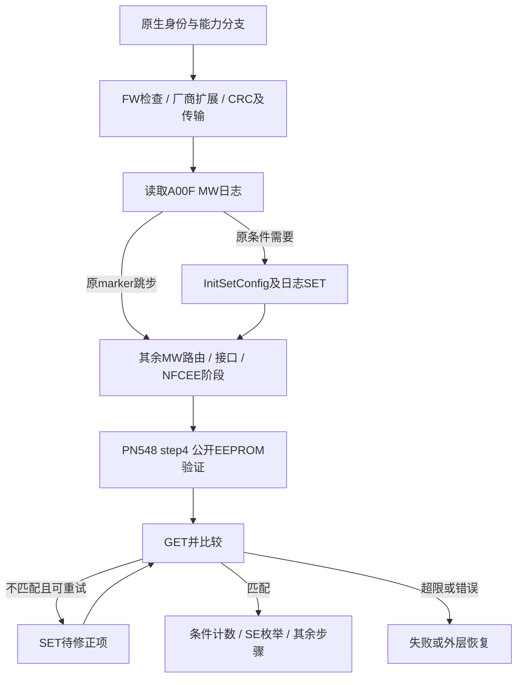

# 23G90 Comet：无 RF 初始化命令与 LoadStack 剩余缺口

2026-10-23。继续仅离线分析同版固件和既有取证副本；未启动／挂载目标实例、运行 HAL／Comet、改变系统／VM 门槛、加载驱动或绑卡。以下帧由构造／解析代码恢复，不是实际收发记录或运行通过证明。

## 判断

**已补齐 FW 接口兼容检查、厂商扩展、主要初始化配置及 EEPROM 日志／配置读回子循环的具体契约；尚未补齐完整原生 LoadStack。** 最小候选可以没有射频收发器，但仍需维护控制器身份、配置库、CRC 切换、异步通知及 NFCEE／SE 生命周期。仅按命令返回 status=0 不能闭环。

本轮同时纠正上轮常量邻行误读：Reset／Init descriptor 实际为 `{type=1,GID=0}`，不是 `{3,1}`。已经沿 CoreIfTxRx → mux2 → CmdTx → CoreBuildCmdPkt 闭环到线上 `20`／`2f` 头，未将内部 ioctl 号当作线上命令。

配套细表：[FW 身份／兼容性](comet_fw_compatibility_20261023.md)、[厂商命令／配置／HSU／CRC](comet_vendor_initialization_20261023.md)、[EEPROM 两条路径](comet_eeprom_protocol_20261023.md)。前轮 [24 步初始化](pn548_nfcc_initialization_20261023.md)、[帧／CRC](pn548_user_frames_crc_20261023.md)、[前端契约](stockholm_hal_frontend_contract_20261023.md) 仍适用。

后续更新：[routing／NFCEE到SE枚举和LoadStack](comet_nfcee_loadstack_closure_20261023.md) 已恢复主要routing／mapping／SWP／discovery及正常ModeSet通知；其中普通mapping分支拒绝interface count0。以下“尚缺”表保留本阶段进度，后续缺口以新报告为准。

## 同版证据及本轮复核

Comet 来源是本地 `iPhone17_3_26.6.2_23G90_Restore-be187396844b.ipsw` 原版 DSC：source `366.9.1.0.0`，UUID `AAD82B14-9985-3582-9A57-22047E668A31`。重建 Mach-O SHA-256 `6503712f79f71f304061c8a53b1094afaa62d902ddee2a38b60d48b46a5f3313`；前轮已逐字核对原始／重建 `__text` 796,896 字节。没有重新读取 guest Comet，不能称已逐字验证部署中的该库。

本轮从同一 IPSW 再提取原 DSC，直接导出并比较六段：`__TEXT.__const/__auth_stubs`、`__AUTH_CONST.__const`、`__AUTH.__data`、`__DATA.__data`、`__DATA_DIRTY.__data`，全部与保留重建库逐字相同。精确 VA `0x2a2fc36a8` 的 8 字节是 `0100000000000000`，说明前轮错误来自常量读取位置，不是提取器改变了 descriptor。下文 VA 均是静态未滑动地址，不是补丁位置。

经 MCP 查阅 [NXP 官方固定版本 nci_defs.h](https://github.com/NXPNFCLinux/linux_libnfc-nci/blob/449538e5e106666e5263afeaddacc5836fc23d3f/src/libnfc-nci/hal/include/nci_defs.h)，仅交叉核对 NCI 的 MT／GID／OID 和 CORE_GET／SET_CONFIG 命名；Apple 私有参数、版本阈值和状态变化以当前二进制为证。

## 无 RF 仍可能必需的命令、响应和状态

表中省略 transport 尾 CRC；`P` 是去掉 NCI 头和 CRC 的响应 payload。RSP 头对应 `40 <OID>` 或 `4f <OID>`，长度来自真实 payload。NCI 层 status、Comet API status、PN548 step 返回值是三层不同值。

| 操作／请求字节 | 成功响应必须提供 | 状态后果／条件 |
| --- | --- | --- |
| RESET：`20 00 01 r` | payload 恰3字节：`00 NCI-version reset-config` | 保存版本与 reset config boolean；按上下文更新 CRC。初次 r=1，其它复位不可统一写死 |
| INIT：`20 01 00` | status、4B features、interface count/list、连接／routing／包长／manufacturer 等；代码固定下限17B | `n=P[5]≤8`，n=0允许；manufacturer 非零时合法结构需至少 `17+n`。身份字段决定后续分支 |
| FW type：`2f 06 00` | 短响应恰2B：status+type；或扩展≥22B：type、4B info、完整控制器能力 | 仅特定分类查询，其它本地推断；扩展变长合法结构至少 `22+n`。失败可回退 type3，不代表身份已验证 |
| FW interface：`2f 19 00` | 恰3B：`00 revision_hi revision_lo` | 对照实际平台期望值；过旧内部 `80`，过新 `81`。原分支可能无需查询 |
| EnablePropExtn：`2f 02 00` | 恰5B：`00 capability[4]` | 后4B按 BE32 OR 入 Lib `+bd8`，影响后续能力；单字节成功不够 |
| standby：`2f 00 01 mode` | 恰1B：`00` | 成功才提交 current／pending 状态；初始化 disable 用 mode0，当前已关闭时可不发 |
| HSU：`2f 03 08 parameters[8]` | 恰1B：`00` | 三族×九档参数，不是通用 baud 数字；某些分类原本跳过，其它分支还须配合 host transport／重读 |
| GET MW 日志：`20 03 03 01 A0 0F` | `00 01 A0 0F 40 value[64]`，payload=69B | 严格64B；首8B为 LE16 MW、LE16 FW、LE32 marker；影响内部配置 sequence |
| SET MW 日志：`20 02 44 01 A0 0F 40 value[64]` | SET_CONFIG parser 至少2B，正常形状 `00 00` | value 首8B由库构造，尾56B清零。读写同一参数，不能把 A00F 当物理 EEPROM 地址 |
| InitSetConfig／公开 EEPROM 验证：`20 02 L count TLVs`，读回 `20 03 L count IDs` | SET 的 status／失败ID列表；GET 的 status／匹配数量、ID、长度、实际值 | 按型号选择标准与 A0／A1 扩展参数；成功 SET 必须反映在后续 GET 中，读回不匹配会修复／重试 |
| CRC 配置单项：`20 02 05 01 A0 BF 01 desired` | 通过真实 SET_CONFIG 响应解析 | desired 0/1；成功响应、driver option、后续 reset 共同迁移 check／skip／append，不能只切 socket option |
| 条件 write-counter enable：`20 02 05 01 A1 54 01 01` | 同真实 SET_CONFIG 解析与异步完成 | PN548 controller-info `+4` 的u32≥8且 PN context `+24b` bit4 才发；不满足为 no-op 成功 |

SET_CONFIG status1／5／9映射内部 `93`，`f9→87`，`fc→9e`，其它失败分支保留；不是收到任意 RSP 即成功。standby 的 `f1→51` 与 `bd→bd`、FW interface 的拒绝／语法错误→`80` 等必须按具体 parser 解释。API 返回 `0d` 通常表示等待异步完成，不是线上成功 status。

InitSetConfig 所见标准 ID 为 `80/81/28/5b`，private 为 `A002/A004/A003/A007/A019/A0d5/A037/A044`；CRC另有 `A0bf`，MW日志另有 `A00f`，条件计数另有 `A154`。完整值／选择条件见厂商细表，不能把所有参数无条件塞进一个命令。普通 TLV 为 `[id,len,value]`，当前扩展 TLV 为 `[A0或A1,low-id,len,value]`；数量按参数计，不按 ID 字节计。

## FW 身份必须跨命令一致

RESET 中的 NCI version、INIT manufacturer info 的 FW 版本、vendor OID19 的接口 revision 是三组来源。令 INIT `n=P[5]`、`b=6+n`：manufacturer ID=`P[b+6]`，非零时读取 info[0..3]=`P[b+7..10]`。info0→平台代码 `Lib+bdc`，info1→`+c01`，`BE16(info2,info3)`→`+bd4`；features 第4字节→`+c40`，共同决定分类与后续检查。

接口期望值按这些分类可为 `0015/002f/002c/0037/0003/0025/0008`，严格相等才兼容；没有“版本越新越兼容”。当前只恢复正常 NCI 身份／接口检查，没有恢复所有下载镜像、签名、SVN／anti-rollback 检查，也没有实际控制器身份可用于选定唯一分支。不得通过挑选虚构平台、marker 或 capability 来压低初始化要求。

## EEPROM 子循环及 PN548 外层失败语义

MW 日志参数的 marker 是 LE32：`c3c3a5a5` 命中时内部 sequence 跳5项；0或 `a5a5c3c3` 置 `Lib+c83=1` 后继续配置；其它值强制继续 MW 配置。此函数只记录 MW／FW 两个版本，不比较它们。SET 写 MW=`0435`、FW=`Lib+bd4`低16位、marker=`c3c3a5a5`，尾56B清零。该 marker 不跳过整个 LoadStack。

公开 `ValidateEepromSettings` 是另一路：构造多参数 GET → 与当前分支期望逐项比较 → 保留不匹配项并 SET → 再 GET。`Lib+cc9` 是配置修复重试计数；仍有不匹配且≥2则返回 `ff`。它不是物理写计数。无法从函数名证明物理地址、断电保存、写入原子性或 EEPROM wear 语义。

公开入口的条件选择集合进一步恢复为16个ID：`28/32/5b/80/81/A019/A0d5/A002/A004/A007/A037/A006/A0ec/A0ed/A0a2/A044`，各项选择条件／比较值／wire value见EEPROM细表；并非每次固定请求16项。注意ID32内存期望枚举1，实际wire value是`20`；A0ec／A0ed值来自上下文配置bit。Proc还可能补写本次GET未选择的A0ec，所以SET集合不能限制为原GET集合。该公开入口不选择A00F或A0BF，它们归前述其它阶段处理。

图中分组不代替原始逐项 sequence；HSU／CRC及 reinit 实际交错顺序见前轮初始化表。NFCEE发现与 routing／mapping 仍有独立条件。

PN548 step4 `_NFDriverValidateEEPROM @0x2a3057508` 的 block `0x2a305a4b0`，在 `...a4f8` 经原岛调用 `phLibNfc_Mgt_ValidateEepromSettings @0x2a2f76628`；立即返回 `0d` 后等待 callback。完整结果处理：

| 该 API 异步结果／等待结果 | PN548 后果 |
| --- | --- |
| 成功 | step返回0 |
| `ff` | 日志 EEPROM validation failed，最多3次外层尝试，耗尽返回1 |
| `43` | 日志 eSE power-on failed，同样最多3次尝试 |
| `89` | 转为 step返回 `0d`；配合该step的 `80` flag，外层可卸载／重跑 LoadMW |
| 其它错误 | 返回1；不作为成功 |

这是 Comet 配置修复计数之外的另一层重试，不能混为“EEPROM写3次”。`43` 是此 API／日志层的值，未把它当作线上 NCI status。eSE 上电与随后 SE 枚举依旧是非 RF 前提。

step5 精确证据：PN548 `0x2a30579a8` 取 `0x2a308aad0` 的4字节 `A1540101`，构造 pointer+length 对象，`...79cc` 送内部 ioctl `90a1`；wrapper `...4f804` 经已核对原岛进入 Mgt_IoCtl。Comet `__AUTH_CONST.__const @0x2b2411c10` 的16B表项 index9 把 `90a1` 映射到 `0x2a2f1053c`，再经 raw SET_CONFIG 在前面加count1。原DSC该4字节与部署副本重建文件相同。该证据只证明启用参数，不证明计数器实际物理实现。

step23 `_NFDriverDisableStandby @0x2a3059b98` 仅在 `NFIsInternalBuild()!=0` 且 PN context `+249` bit3置位时调用 standby 操作，本step末尾返回0；不可与 MW 的 DisableStandbyMode 混为一个无条件步骤。本轮没有执行任一 predicate。

## 能否据此补齐最小闭环

| 范围 | 当前可以收敛的规格 | 尚缺的证据／实现 |
| --- | --- | --- |
| 配置子循环 | 真实NCI编码、FW revision比较、扩展能力字段、standby／HSU、主要配置TLV、A00F读写及重读修复、CRC迁移 | 各分支真实选择值、能力bit语义、全部通知与异常恢复；未运行原生parser／模型 |
| 完整 Comet MW | 上述配置是必经或条件步骤，不是全部阶段 | listen routing／mapping、SWP、GetNfceeIntfCfg、NFCEE discovery通知、SE供电与完成状态的完整wire契约 |
| PN548 LoadStack | 条件步骤表、EEPROM与eSE错误／重试、计数条件已清楚 | 真实SE枚举结果和原生完成路径；不能拿内部跳步或单个status替代 |
| 当前vphone接入 | HAL／前端与宿主后端的职责边界仍成立 | VM gate保留；guest驱动准入、匹配provider、完整前端ABI和宿主状态机均未实现／验证 |

下一段最小离线工作应沿剩下的 routing／mapping → SWP／NFCEE interface → discovery响应／通知 → SE枚举完成，列出真实所需端点和状态。这样才能判断是否还缺 HCI／连接／credit／wired 准备；APDU socket或支付SE身份不能替代这些层。当前可以定义配置模型的验收条件，**不能宣布 LoadStack、非RF APDU或 Wallet 可用**。

## 验证与收尾

本轮保留 `.build/validation/comet-config-20261023/` 下 `vendor/fw/eeprom/integration/raw` 小型证据：原始段与比较结果、精确常量、HSU27条参数、各函数摘录、条件计数完整链与静态约束复核。父任务独立复核六段逐字相同、两个descriptor、27个HSU值、counter原始值／表项、EEPROM帧长及BE版本布局；`integration/independent-validation.json` 保存结果。验证只涉及宿主读取字节和布局／比较算术，没有加载Apple库、向原生栈提交回复或运行控制器服务；不以手写比较算术冒充运行本版兼容检查。

原IPSW提取工具的临时固件镜像挂载已退出；统一清理本轮约5.8GiB可重建DSC缓存，保留小型证据。目标 `5-20261023/Disk.img` 大小／mtime／ctime与前轮一致；未安装诊断App，未创建服务器。没有产品代码、固件补丁、版本或 `.env` 改动。
