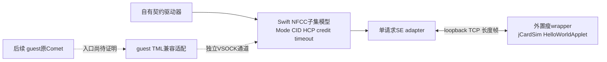

# 23G90：最小无RF原型方案与验收门槛

后续状态：同日已按以下M0范围完成[宿主实现与真实jCardSim验收](nfc_no_rf_m0_implementation_20261023.md)。
本方案正文保留提出时的状态；实施采用现有独立swiftc runner模式，未新增Xcode产品target；实际后端为固定
Maven发布分支`com.klinec:jcardsim:3.0.5.11`，与此前Licel源码调查基线区分。M1及后续阶段仍未实施。

2026-10-23。目标为既有23G90契约的可实现收敛；本轮只调查源码、离线证据及MCP官方／作者源码，不实现、构建、部署或运行原型。未启动／挂载5-20261023、运行Apple库／Java／服务、改系统或VM门槛、绑卡。所有下述新类型、target、协议和宏均为**拟新增**，不是已有能力。

## 选择与首个闭环

**先做宿主独立协议模型＋外置jCardSim的真实APDU闭环，再验证原生Comet能否接入同一后端。** 不以移植实体Stockholm驱动作为首期前提。已有代码可复用传输模式和卡执行器，尚无可直接运行的23G90完整前端／SE Demo。

M0的最小完成物是：一份隔离的Swift研究工具、一个外置Java瘦wrapper、模型与进程间测试。用上游现成HelloWorldApplet执行SELECT、两次不同nonce echo及未知INS；回答取自实际执行结果，不在适配器填9000。M0不需要guest或Apple私有库，不声称完成原生LoadStack。

这里“兼容前端”包含guest呈现接口和NFCC协议模型；“宿主SE后端”只负责真实会话／APDU执行。M0只实现前端的宿主协议子集。虚拟NFCC的软件配置是实验模型状态，不能冒称实体芯片测量值或Apple可信SE身份。

## 已有实现、真正可复用部分和缺失接口

详证：[仓库接入核对](nfc_no_rf_repository_reuse_plan_20261023.md)、[原库／guest前端核对](nfc_no_rf_guest_frontend_plan_20261023.md)、[后端源码核对](nfc_no_rf_backend_reuse_plan_20261023.md)。当前本地HEAD为`b4f124bbd496089ba791cc18732bf9eed526d2a7`；按当前脏工作树核对，不冒称全部已部署。

| 位置／实现 | 可以复用 | 还缺什么／接入点 |
| --- | --- | --- |
| [VM AppDelegate](../../VPhoneExecutable/VPhoneVirtualization/UI/VPhoneVirtualMachineAppDelegate.swift) `startVirtualMachine / stopControlServices` | 当前VM的VZ socket device及启停所有权 | 后续宏内一个adapter装配／停止钩子；重启换device、清代次。M0不改此文件 |
| [CameraServer](../../VPhoneExecutable/VPhoneVirtualization/UI/HostDevices/VPhoneCameraServer.swift) | host主动connect guest独立端口、保留VZ connection／FD、断连生命周期的现有模式 | 双向研究帧、背压与事务语义另实现；不复制BGRA或相机测试数据 |
| [APIProxy](../../VPhoneExecutable/VPhoneVirtualization/UI/GuestCommunication/VPhoneAPIProxy.swift) | NIO接FD、写完成与关闭的实现参考 | provider／relay是private且绑定1339／HTTP，不能直接当任意端口公共API |
| [guest main](../../VPhoneDaemon/Daemon/main.swift)、[native camera](../../VPhoneDaemon/Native/vphoned_vcam.m) | root worker在watch_proxy后启动native VSOCK listener、短读／EINTR模式 | 独立研究listener及停止／错误处理；不能假定临时App有同样sandbox权限 |
| [UnixSocket](../../VPhoneKit/VPhoneCoreKit/Process/VPhoneUnixSocket.swift) | 现有AF_UNIX client连接／FD失败清理 | jCardSim桥为TCP；没有所需TCP listener、长度帧、取消与请求关联，不为这次需求扩成通用平台 |
| jCardSim `41511ec2a3d3dfa7a5fe2d07f5b4e56bc9c8dd56` | `Simulator.installApplet / transmitCommand / reset`、现成HelloWorldApplet及`VSmartCardTCPProtocol` | 新瘦wrapper、Swift adapter；本机未编译。没有NCI、HCI、Comet、WTX或Apple SE身份 |
| vsmartcard／libcacard／NXP libnfc-nci | 卡／reader生命周期或标准NCI定义可参考 | 均非Apple控制器模拟器；不引入完整PC/SC、Python、GLib/NSS或Linux host stack作为首期依赖 |

现有[VM配置](../../VPhoneExecutable/VPhoneVirtualization/UI/VirtualMachine/VPhoneVirtualMachine.swift)有通用VSOCK及虚拟SEP，定向范围未找到Stockholm设备组装。VSOCK运输不会自动创建NFCC／SE。Apple也区分[主动connect与host listener](https://developer.apple.com/documentation/virtualization/vzvirtiosocketdevice)；本仓库复用率最高的是host connect→guest listener方向，guest可以在同一双向流发请求。

## M0：最少新代码与边界

优先放入独立`Integrations/NFCNoRF/`研究目录，使用清晰的owner源文件／测试目录。拟通过现有手写Xcode工程增加研究专用命令与测试target；不改CLI公开命令、不新增SwiftPM app target，不stage进VPhone.bundle。有真实跨target共享需求后再提取library，不先建插件框架。

| 拟新增部分 | 首期职责／不扩大的范围 |
| --- | --- |
| 契约驱动器＋trace | 显式创建研究端点／连接／pipe，驱动软件Off→Apdu及数据事务；不是伪造Apple初始化callback的harness |
| 23G90子集模型 | 有界NCI/HCP编解码、动态CID／MPS／credit、pipe与pending关联、接收容量、deadline及移除；只支持明确声明的普通APDU路径 |
| Swift SE adapter | loopback TCP listener、完整短读／短写、u16be长度帧、单笔在途、错误与generation屏障；不需要RMI或第二种自定义网络协议 |
| 外置瘦Java wrapper | 直接安装现成研究applet，复用TCPProtocol主动连接Swift，串行reset／ATR／APDU与关闭；不引用ReloadThread，不开放其默认8099端口 |
| 所属测试 | 编解码／状态与故障测试，以及实际jCardSim进程往返；测试fixture仅在测试中，不作dev/prod后端 |

jCardSim的[现成TCP实现](https://github.com/licel/jcardsim/blob/41511ec2a3d3dfa7a5fe2d07f5b4e56bc9c8dd56/src/main/java/com/licel/jcardsim/remote/VSmartCard.java)由Java主动连接；u16be长度＋payload中长度1是控制字。RESET／POWER_ON会reset但**无ACK**，POWER_OFF常量没有对应处理，不能据写入完成宣布SE状态已变化。标准wire无请求ID；ID与代次仅为本地适配关联，不偷偷加到NCI／HCP或上游TCP帧。

wrapper须显式`installApplet`，不能只设置AID/Class配置后当成已安装；后者仅load。M0复用[上游HelloWorldApplet](https://github.com/licel/jcardsim/blob/41511ec2a3d3dfa7a5fe2d07f5b4e56bc9c8dd56/src/main/java/com/licel/jcardsim/samples/HelloWorldApplet.java)，无需首期再写counter applet。Java／Maven／Java Card API构建与依赖许可仍须实际检查；本机仅只读看到JDK目录，未证明工具链可用。

## 两侧接口与必须保留的事务契约

以下是拟实现的内部语义，不是现有SDK或已恢复完整的TML C ABI。首期单一会话、单笔在途即可；不设计并行池、多租户协议或自动切换后端。

| 接口／状态 | 兼容前端 | SE adapter／实际后端 |
| --- | --- | --- |
| 能力与会话 | 声明本模型支持的模式／最大帧／限制；unsupported不置ready | 实际安装／连接结果、可用applet和传输上限；新连接增加generation |
| `setMode(Off/Apdu)` | Off停止新请求；Apdu仅在端点与资源就绪后提交软件状态 | jCardSim无Apple电源API；不能声称物理eSE上电。reset后的SELECT完成作为执行可用性检查 |
| `transceive(generation,id,bytes,capacity,deadline)` | 保存CID／pipe、接收容量、deadline；透传真实R-APDU与SW | 串行执行实际APDU，返回bytes或独立transport错误；SW失败不等于transport失败 |
| credit与分片 | 每实际NCI提交消耗额度，零额度暂停；HCP首片253／续片254与NCI MPS两层切片 | 提供实际接收／队列背压；credit回补表示可接收容量，不冒充APDU已完成 |
| `cancel / timeout` | 终止模型pending且只交一次模型结果，抑制旧回答 | 无中断／回滚保证。M0安全做法为关闭旧连接并重建wrapper／会话；禁止立即复用无ID旧流给新请求 |
| `remove / EOF / reset` | 清record／CID／pipe／片链与pending，增加generation，重建前不可用 | 保存实际错误；恢复后重新reset／SELECT。已执行applet副作用不可声称回滚 |
| WTX／progress | 有真实progress源才编码HCP11、延长对应计时；无源则真实timeout | 标准TCP接口无progress；M0不周期造WTX。WTX算法仅在测试fixture验证，原生真WTX后置 |

普通Comet路径按[已恢复契约](comet_apdu_minimum_contract_20261023.md)：Comet API mode2→event8c→Apdu3，full wire enable仍为mode1；APDU发送及回答均为同pipe HCP DATA type1／ins10（`[80|pipe,50,APDU]`），ANY_OK不能完成事务。动态CID不等于NFCEE协议ID c0或pipe；ff credit本版也会减为fe，首期仅使用已核对单pair补额。

M0驱动器只测试自己实现的子集，不隐式seed一套“原生初始化成功”状态。未实现的RESET／FW／EEPROM／HCI child等请求明确unsupported；不得以固定成功、固定Session或虚构GetConfig迎合原库。未来软件控制器的型号／配置／Session必须有独立、前后一致且可重置的模型语义，与jCardSim ATR、Apple UID／支付applet／密钥／SEP配对分开。

## 原生接入：先证明入口，再补完整初始化

**Comet→HAL的14个`phTmlNfc_*`导入是最窄候选，但尚无已验证的transport注册／替换入口。** 包括Init、Read/Write、ReadAbort/WriteAbort、IoCtl、Flush、Shutdown及SPMI／HSU／测试／错误配置。仅Read/Write五个寄存器参数观察不等于完整typedef、完成结果结构和所有权已恢复。

原HAL Init固定调用NFHardwareInterfaceOpen；内部函数表非公开setter。两级namespace绑定固定`/usr/lib/libNFC_HAL.dylib`，dlsym不改原导入；`/dev/*`路径／PTY也尚未证明满足termios、GPIO、reset与profile。M1先补ABI、合法绑定、签名／sandbox与原库运行身份；未证明就停在“原库入口未接入”，不制造成功callback或用动态注入绕过权限边界。

原库为iOS arm64e，分析重建Mach-O不等于macOS可运行包。M1在guest原系统路径／共享缓存加载本版Comet，独立核对UUID／哈希；不能直接dlopen宿主提取物。目标vphone600为Darwin25.4，实体donor为Darwin25.6，直接搬Stockholm还缺KC／ABI／provider及SPMI/AOP硬件后端，不选作首期捷径。

| 阶段 | 进入条件与必须新增 | 成功后允许的结论 |
| --- | --- | --- |
| M0 宿主子集 | 工具链实际可构建、真实jCardSim、上述有限模型 | 自有模型完成真实APDU及故障闭环 |
| M1a 原Comet入口 | 14项ABI／绑定与guest运行准入证明；隔离TML适配及桥接 | 原库实际使用实验transport，尚不宣称初始化成功 |
| M1b 原Comet初始化＋APDU | 当前profile的全部必选／条件契约，见下表；真实三参init、五参mode、六参data分别追踪 | 本版原Comet控制面与一笔真实测试APDU可用 |
| M2 原PN548 harness | 完整Open配置／队列／等待／关闭ABI；自然执行LoadMW及24步策略 | 本次普通LoadStack正常成功且eSE可执行；排除旧loaded／DL-only／仅Host列表 |
| M3 stock nfcd | 正常准入的guest内核前端、系统集成及另行评估VM门槛 | 原daemon对应能力；仍不能由此推导Wallet／绑卡成功 |

| 原生初始化组 | 前端必须实际实现的状态，不能靠SE APDU服务替代 | 既有依据 |
| --- | --- | --- |
| NFCC／FW／配置 | RESET／INIT、分类与FW interface严格兼容、vendor能力；按实际profile选HSU／standby、A0BF与driver CRC迁移；A00F／其它SET→GET读回一致 | [配置／CRC／EEPROM](comet_no_rf_loadstack_commands_20261023.md) |
| routing／mapping／NFCEE | 自然选中的routing、mapping、SWP/interface与discovery RSP／NTF；普通mapping拒绝interface count0，不能用空列表取巧 | [NFCEE闭环](comet_nfcee_loadstack_closure_20261023.md) |
| HCI child | 动态CID/MPS/credit，admin OPEN／allow list／pipe通知，8B Session查询／条件清除／重初始化及EoOp | [HCI契约](comet_hci_minimum_closure_20261023.md) |
| 完成与对象 | event75按current Idle恢复event05并消费17d8初始callback；四后置事件仅软件归一；record／PN对象未removed、pipe有效 | [最终路由](comet_event75_final_closure_20261023.md)、[对象生命周期](comet_se_post_init_closure_20261023.md) |
| SetMode／APDU | RSP、匹配通知／本profile timer来源分开，DATA／credit／capacity／WTX／移除与最终真实bytes | [数据契约](comet_apdu_minimum_contract_20261023.md) |

后续桥接仍选host主动连接guest独立listener，端口尚未分配，避开1338／1339。host窄钩子在VMKit AppDelegate，guest窄钩子在vphoned worker watch_proxy后；研究主体留在独立目录。新桥必须区分控制／异步完成／字节帧、版本、长度上限、序号与断连reset，不将VSOCK可写当硬件ready；不往GuestAPI、manifest、Launchpad或helper协议塞NFC业务字段。

若必须保留原HAL而不是TML候选，新guest前端还要正常呈现Stockholm服务／provider、type0 UserClient的12个scalar selectors、`com.apple.spmi.nfc` kernel-control、CRC／OnDemand／错误options及独立IOKit interest通知。用户态同名socket不能替代；详见[前端清单](nfc_no_rf_guest_frontend_plan_20261023.md)。

## 独立宏与删除方案

沿专项建议采用一个首期功能宏 **`VPHONE_EXPERIMENTAL_NFC_NO_RF`**，默认未定义，与Wallet／现有设置隐藏补丁分离。M0仅研究target使用；将来host／guest接入时，各所属target显式配置同一功能条件，不预加未用开关。Swift移除定义即关闭，C/ObjC用`#if defined(...) && ...`；Java wrapper的研究源集／构建profile及复制动作也须由显式同名构建门控默认排除，不能只靠Swift -D或JVM运行时bool。

当前没有这些宏或target。VMKit／daemon尚无可直接复用的统一xcconfig；实施时绑定所属窄配置，不改Launchpad无关配置。StageBundle以`env -i`另起guest xcodebuild／make，必须明确传播并核对实际编译命令；M0工具和JVM不进入该流水线。以后新增组件还须独立核对stage、签名、安装及关闭分支。

宏关：不编入实验主体、不注册命令／端口／后台任务、不构建／复制wrapper，基础VM仍按原路径。删除：移除隔离目录、研究target／测试／构建源集、窄钩子和专属依赖。关闭源码宏不能回滚已部署系统补丁；本方案首期没有这类持久改动。遵循[编译开关规范](../../Documents/Guides/architecture-boundaries.md#定制与实验功能的编译开关)，不改官方版本号／local内容哈希机制。

## 首个可运行闭环的验收顺序

这些是**后续实施步骤，尚未执行**；研究target／wrapper不存在，因此不提供貌似已可用的启动命令。

1. 固定上述源码SHA、许可及产物哈希；核对JDK实际架构／版本、Maven、JC_CLASSIC_HOME和API依赖可用，构建真实上游与瘦wrapper。依赖失败就记录具体缺项，不能用模拟回答替换。
2. 分别构建宏关闭／开启的研究target；关闭时无实验入口／监听／wrapper产物且基础构建通过。外置依赖不进入[VPhone.bundle验收范围](../../VPhoneExecutable/VPhoneVirtualization/Build/ValidateBundle.sh)内冒充系统依赖。
3. 启动前按PID／路径核对并停止此前同一研究任务残留服务；仅bind loopback临时TCP端口，不启动8099 reloader，不停止用户VM或无关服务。Swift先监听，wrapper再主动连接。
4. wrapper显式安装研究AID，驱动真实SELECT。发送两次不同nonce echo（INS01／P1=01）与未知INS；逐字比对nonce及真实返回SW，未知INS必须是applet失败状态；记录backend执行与前端收到的同一请求。
5. 明确创建模型端点／连接／pipe后，Off拒绝、Apdu接受；经完整HCP→NCI数据路径返回同pipe DATA。模型最终callback仅一次，status、接收len、buffer与实际R-APDU一致；ANY_OK、错误CID／pipe不能完成。
6. 测HCP payload253／254边界、不同MPS、NCI PBF及流拆粘包；先用test fixture覆盖阈值与异常，再让真实后端处理其支持长度。credit0必须暂停，匹配单pair正额度才恢复，每片只扣一次；ff不能当无限额度。
7. 测接收容量不足、不回应、credit耗尽、backend EOF、取消与移除后晚到数据；失败不能交成功bytes。标准TCP无ID，超时／取消后必须销毁旧会话屏障，重建并reset／SELECT后再收下一笔；不重放有副作用APDU。WTX仅做算法fixture测试，不伪造后端进度。
8. 停止工具／wrapper、关闭FD与临时端口、清本次可重建产物，保留最小trace及哈希。清理后宏关闭基础路径验证通过；M0结果单独标注“宿主模型”，再决定M1a入口验证，不越级报Comet／LoadStack／Wallet成功。

后续M1另须验跨VM代次／实例隔离、host有而guest无能力、旧pinned bundle、VM重启换device、端口冲突、实验失败不影响1339／相机。每层分别记录状态迁移、命令／响应、credit、timer来源、真实callback种类和错误；APDU payload只保留自有研究数据。

## 本轮交付与静态核对

交付本方案及三份专项报告；原APDU契约与研究日志增加链接。只增加研究文档，没有产品代码、空宏、target、二进制补丁、运行服务或部署产物，因此不修改补丁比较表、不运行产品构建测试。

小型证据位于忽略目录`.build/validation/nfc-no-rf-prototype-20261023/`，含源码来源／哈希、定向反汇编摘录与静态验证结果。文档链接／空白与target Disk.img的size／mtime／ctime核对属于本轮验证，不等于上述任何运行验收已通过。
