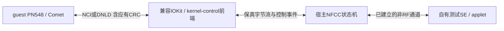

# 23G90 PN548／Stockholm：无 RF 最小协议闭环

2026-10-23。仅离线读取现有固件、此前目标取证副本与官方公开源码；未启动／挂载实例、改系统、绕过 NFProductIsVM、加载驱动、调用 HAL／SE API 或绑卡。宿主执行了纯算法／帧布局复核，没有运行控制器服务或虚拟设备。

## 结论

**已经能划出不含射频收发器的最小协议模型边界，并恢复具体 NCI／下载帧及 CRC；仍不能称为已走通原生 LoadStack／SE 会话的闭环。** 前端不需要重复实现 Comet 的上层协议与 CRC算法，宿主后端却必须真正实现控制器状态机，不能只转发 APDU 或固定返回 success。

本轮新确认：PN548 主要负责编排，实际 `phLibNfc_*` 初始化、NCI构帧／解析及CRC在 **libNFC_Comet**。普通初始化至少跨 Open transport → Comet middleware初始化 → PN548条件步骤表 → SE枚举／会话。不能把 CORE_RESET／CORE_INIT 一对回复当作所有阶段完成。

配套：[初始化链与条件表](pn548_nfcc_initialization_20261023.md)、[用户态帧／CRC](pn548_user_frames_crc_20261023.md)、[Stockholm内核搬运](stockholm_spmi_frame_crc_20261023.md)。前轮已恢复的12项控制、4个options与IOKit通知见 [HAL接口清单](stockholm_hal_frontend_contract_20261023.md)。

## 版本与证据身份

| 对象 | 来源／本轮核对 |
| --- | --- |
| libPN548_API、libNFC_HAL | 既有目标部署副本，23G90／366.9.1；前轮已与同版IPSW原版代码段逐字比较。PN548本轮再次与新提取DSC的274,720字节原始text比较相同 |
| libNFC_Comet | 同一本地 `iPhone17_3_26.6.2_23G90_Restore-be187396844b.ipsw` 的原版DSC；LC_SOURCE_VERSION=366.9.1.0.0，UUID `AAD82B14-9985-3582-9A57-22047E668A31` |
| Comet分析产物 | 重建Mach-O 1,159,968字节，SHA-256 `6503712f79f71f304061c8a53b1094afaa62d902ddee2a38b60d48b46a5f3313`；不是guest独立文件摘要 |
| Comet代码段 | 原DSC导出与重建产物逐字相同：796,896字节，SHA-256 `852ae02b2369b5ff4c5cda0a5302b5d502b5d1182e0bfc57dacce6a576d624bf` |
| 内核 | 同版实体 release.iphone17 的 StockholmControl，与实际 research.vphone600目标比较；两端Darwin25.6／25.4并非同版内核 |

**Comet本轮仅独立验证了IPSW原版与提取产物，未重新读取guest Comet做部署逐字比较。** 不因DSC UUID相同就假称整个部署缓存相同。当前原版DSC UUID仍为 `F216D3F4-7064-3359-8840-41C1D1A2A72E`。

PN548外部调用继续避开错误的otool重建stub标签：以原岛代码、库内stub指针槽／直接目标交叉映射，190/205个所见非空岛有确切目标名字；未命名部分保留，不从近邻猜测。Comet内部函数名以实际日志xref／函数边界和调用恢复为主，详见子报告。

## 谁负责哪一层

本文“DH”指guest中的PN548／Comet，NXP资料中的host通常也是这个角色；“宿主后端”专指Mac上的候选控制器模型，避免混用。

| 层 | 必须承担的职责 | 本轮可排除的重复工作 |
| --- | --- | --- |
| 既有PN548／Comet | 初始化编排，NCI command/data、分片、异步应答匹配、超时、TX CRC追加／RX CRC验证 | 不需要由前端重新实现这些库函数；本轮未替换或调用它们 |
| 兼容前端 | 服务／授权、12项控制、power/reset/download模式同步、CRC／OnDemand等options、stream与背压／取消、IOKit错误通知 | 较高层实现不必复制物理SPMI寄存器或完整AOP；**不能再追加CRC或剥掉尾CRC** |
| 宿主NFCC后端 | 按当前模式解析命令，验证guest方向CRC，生成应有RSP／NTF及CRC，维护版本／能力／配置、异步状态、NFCEE／连接／credit | 无RF模型不需要天线波形和射频收发；仍需处理初始化实际使用的厂商／配置命令 |
| 自有测试SE后端 | 正确绑定到已枚举端点，在建立的通道上执行自有applet APDU | 普通9000不能替代NFCC初始化、HCI／wired通道或支付可信身份 |

现有VSOCK只是候选桥接载体，不能让原HAL把它直接当Darwin kernel-control。复用实体Stockholm再替换provider则仍需SPMI的读写／中断ABI；不能把上表较高层方案误称为直接移植实体驱动。

## 帧格式与 CRC 已恢复到什么程度

| 模式 | 线上布局 | 长度及CRC行为 |
| --- | --- | --- |
| 普通NCI，CRC关闭 | `h0 h1 P payload[P]` | 3字节头；P是u8，不含头；总长3+P |
| 普通NCI，CRC开启 | `h0 h1 P payload[P] crc_hi crc_lo` | 总长3+P+2；CRC存在／检查／TX追加分别受软件状态控制，不是NCI标准固定带CRC |
| 普通下载DNLD | `len_hi len_lo payload[P] crc_hi crc_lo` | 2字节BE头；当前普通响应validator要求BE16头=P=总长-4；CRC必有 |

NCI h0 的MT为bits7:5、PBF为bit4、低4位为control GID或data connection ID；control h1低6位为OID；h2为payload长度。当前Comet接收data／response／notification，拒绝NFCC向DH发command。control发送不支持超长command分片，data发送另有分片和credit等待。该事实同时由当前指令与 [NXP官方NCI定义](https://github.com/NXPNFCLinux/linux_libnfc-nci/blob/449538e5e106666e5263afeaddacc5836fc23d3f/src/libnfc-nci/hal/include/nci_defs.h) 的标准字段含义交叉说明；后者不是Apple私有扩展实现。

下载头的总线长度策略与用户态validator还须分开：实体D47 `nfccModel=0xd3` 时Stockholm读取 `((h0&0x1f)<<8)|h1`，其它部分model用mask0x03。不能据这个mask就假定普通Comet下载响应允许任意高位flag。下载命令／错误恢复及eSE download还有各自分支，不能与wired APDU混为一套格式。

CRC直接恢复自Comet `phNciNfc_CalcCrc16`（`0x2a2f03bc8`）与完整256项表：poly **0x1021**、seed **0xffff**、不反射、xorout **0**。覆盖完整header+payload，结果高字节在前追加；RX对总长减2重算，再与尾BE16比较。普通NCI和DNLD构帧均调用此函数，RF CRC-A／CRC-B和固件section完整性校验不由此等同。

Stockholm仅按模式读头和payload：NCI按CRC flag决定是否再读2字节，DNLD无条件多读2字节，正常数据链不生成／验证／剥离这两字节；Comet接收时再扣掉逻辑长度和校验。Power／follower reset还会清内核CRC状态，download控制改变接收解析模式。后端、前端、Comet各自状态必须按初始化响应时点一致，不能永久固定CRC on/off。

Comet区分append、check、skip、requested CRC四个状态；skip只暂停比较，不取消接收／扣除尾部。精确位置、失败码和native片段见用户态报告。前端“修好”坏CRC再交给Comet会掩盖协议错误。

## 初始化与无 RF 的范围

初始化至少有三层，顺序与条件以配套表为准：

1. **Open／transport准备**：匹配控制器、打开控制与stream、设置GPIO／下载／电源状态，准备异步I/O；不等于已做CORE_INIT。
2. **Comet middleware初始化**：底层reset/init及能力解析；上层还有HSU、CRC／reinit、固件类型／兼容性、厂商扩展、EEPROM／配置、routing／mapping、SWP／NFCEE发现等条件步骤。RESET／INIT的status和长度、版本及能力字段都会影响后续流程。
3. **PN548 LoadStack后续表**：MW成功后执行24项条件步骤，涉及通知、controllerinfo、baud、CRC、EEPROM／eSEpower、计数与SE枚举，以及HCE／RF／温度／routing／standby策略。

底层实际表指向 InitReset `0x2a2f458c8`／ProcessResetRsp `0x2a2f45c88`，再到 Init `0x2a2f45dec`／ProcessInitRsp `0x2a2f45f48`。后续精确常量／encoder核对已闭环线上 Reset `20 00 01 r`、Init `20 01 00`（不含可选CRC），并纠正初始化子报告此前descriptor邻行误读；这是静态构造证据，不是抓包。Reset响应要求payload长度3并解析status／version／reset type；Init响应代码固定下限17字节，RF interface count≤8；manufacturer非零的合法变长结构实际需至少17+n字节。interface count可以为0，但其余字段不能省略。status=0一个字节不足以完成解析；额外RESET_NTF是否每条路径必需也未证明。详见 [后续Comet命令表](comet_no_rf_loadstack_commands_20261023.md)。

原实现确有 **NFProductHasNFCRadio()** 门控：PN548表中flag0x8的一组RF相关项可在产品能力为false时跳过。但“不需要RF”的需求不等于该predicate实测为false，本轮没有运行它，也没有修改返回值或产品声明。不能把所有RF配置都称无条件必经，也不能按需求自行删掉正常路径会发的命令。

即使原判定为false，核心通知／控制器信息／CRC／EEPROM与eSE供电／SE枚举等仍不由这一位自动跳过，其它mode和flags另行决定；Comet更低层初始化也有自己的分支。可以不模拟实际RF发现／天线，而仍需要实现收到的配置命令的真实状态语义。

固件／能力不匹配时可能进入下载或恢复；目前不能承诺“永远只用普通NCI、下载协议完全不需要”。没有修改兼容检查、伪造芯片身份或以虚假成功压过失败路径。

## 可以收敛的最小验收分级

| 级别 | 无RF目标 | 当前完成情况／缺口 |
| --- | --- | --- |
| L0：离线帧契约 | NCI／DNLD长度、CRC、拆包／粘包与坏帧拒绝 | CRC表256项与4向量复核；独立宿主布局检查通过；没有执行私有库或控制器 |
| L1：控制器通信 | reset → 对应响应／必要通知 → init → 能力解析；正确CRC状态切换及超时 | 静态调用与字段契约已恢复；尚无执行模型和原库通过证据 |
| L2：Apple栈初始化 | 按所选原生分支完成Comet配置、PN548后续步骤；保持RF无活动 | 后续已恢复主要厂商payload、FW接口检查及EEPROM子循环；routing／SWP／NFCEE等仍缺完整契约，**不能宣布LoadStack闭环** |
| L3：非RF测试SE | NFCEE枚举 → mode／连接／credit／wired准备 → 自有测试APDU往返 | 路由／端点状态和实际交互未闭环；独立APDU demo不满足这一层 |

因此，最小候选不是完整手机／天线模拟器，而是**带生命周期、配置、异步通知和NFCEE状态的NFCC协议端点，加普通测试SE**。应先实现并验证L1，再对实际触发的L2命令逐项闭环，最后处理L3；没有必要先做RF发现或银行卡场景。本轮只确定规格与缺口，未实施这套模型。

L3并非多接一个APDU socket即可：当前PN548 `NFDriverGetSecureElementInfo`（`0x2a307c2a4`）检查已枚举对象及wired状态，Transceive（`0x2a3073b30`）还区分SE recovery、无对象与不可用OS。本轮保留了函数边界内证据，未完整恢复全部HCI／eSE连接建立和透传路径，不用独立applet的成功绕过这些前提。

在当前“不改系统／不绕过门槛”约束下，未来独立宿主模型也不能证明现用vphone的nfcd会进入该前端。原VM gate仍保留，guest驱动准入和完整ABI仍是独立未解决项。

## 本轮验证和收尾

除代理的CRC全表比较外，另以逐位法和原表法独立核对4个向量；普通NCI／DNLD布局的完整帧、单字节篡改、截短、所有两段拆分点、两帧粘连和NCI CRC关闭形式均检查通过。它们是从已恢复公式写出的宿主算术／布局断言，**不是运行Apple parser，也不是构造成功NFCC响应或真实会话捕获**。

例如ASCII `123456789 → 29b1`；任意布局示例 `20 00 01 00 → 80 bf`。该例仅说明覆盖和尾序，不代表抓到的初始化报文。原版Comet的native／rebuilt text cmp与PN548重新比较均通过；各报告链接／空白检查完成。

证据在Git忽略的 `.build/validation/nfcc-protocol-20261023/`：`comet/`保存同版库、原始代码段和metadata，`init/`保存实际步骤表与初始化片段，`user-frames/`保存CRC表／算法与构帧证据，`kernel/`保存收帧／模式／CRC flag链，`integration/`保存PN548岛映射、SE路径摘录和independent-frame-validation.json。只保留研究副本，不进入产品运行时。

提取使用本地IPSW中间镜像，其工具挂载收尾已退出；约5.8GiB可重建DSC中间件统一清理。目标Disk.img大小／mtime／ctime与前轮一致。本轮没有App／服务器需要卸载，没有产品代码、驱动、固件补丁或版本变更。
