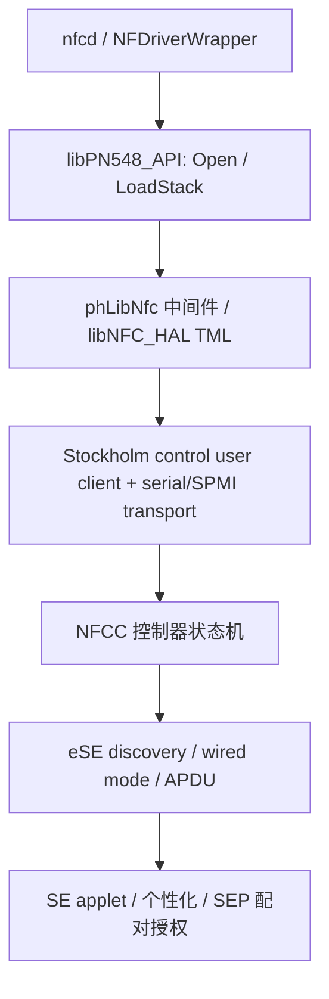

# 绕过 VM 判断之后：驱动、控制器与支付 SE 的依赖

2026-10-23，源码／已有证据分析。用户授权范围：研究绕过 `NFProductIsVM` 后还缺什么、哪些开源实现可参考；不修改系统、不绑卡。本轮没有启动 VM、安装 App、注入、修改 predicate 或制作补丁。

后续 [同版库与实际启动内核离线核对](nfc_current_stack_offline_audit_20261023.md) 已完成：两库与 23G90 原版代码一致，当前 HAL 的具体匹配要求已确认；实际 active Preboot 集合未见具体 Stockholm 驱动／人格／类。下文“未提取当前 HAL／尚未枚举当前 kernel collection”等内容保留为此前轮次的证据范围，已由后续核对补齐。

## 结论

**现有用户态 NFC 软件并不等于已存在虚拟 NFC／SE 设备。** 绕过一个判断，只能让代码继续尝试打开设备。对当前 vphone，后续至少要补齐：

1. 原生 HAL 可发现、可打开的控制／传输端点，及其电源、复位、唤醒语义。
2. 与原生中间件兼容的 NFCC 控制器协议和初始化状态机。
3. 可枚举、可切到 wired mode、能实际处理 APDU 的 eSE 后端。
4. 支付 SE 上的管理／发行方 applet、个性化、设备身份及与 SEP 的授权配对。

前 3 项能分别做实验；任何一项的成功均不能代替第 4 项。没有找到可直接接入 vphone、已经展示真实 Wallet 绑卡闭环的开源后端；具体项目与已验证接口见 [开源参考核对](se_backend_open_source_references_20261023.md)。

## 证据版本必须分开

| 来源 | 本轮能确认什么 | 不能扩大的结论 |
| --- | --- | --- |
| 实例 `5-20261023` 的前次探针 | `NFProductIsVM=1`；实际 nfcd 完整 SHA／UUID 等于 23G90 原始文件 | 本轮没有再次运行探针；未逐指令跟踪 daemon |
| 同一 26.6.2 / 23G90 nfcd 符号与反汇编 | `NFDriverOpen/LoadStack/GetControllerInfo/GetSecureElementInfo/SecureElementTransceive` 导入来自 `libPN548_API.dylib`，并有实际调用点 | 未提取、核对当前共享缓存内 HAL／PN548 库的完整实现 |
| 作者发布的 26.1 / 23B85 反编译，固定 SHA `90aa0cfe59d9682b4265e1354c8b19ec3c7823ab` | 可具体分析 PN548 API、HAL 的 provider／transport／wired mode 实现 | 是逆向产物，不是 Apple 开源源码、可直接编译的驱动，不能当作当前版本完全相同 |
| 原始 vphone600／D47 树及此前 live registry | 原树缺 NFC 链，实际 registry 未见对应 provider；实体树有完整描述 | 没有枚举当前 kernel collection 的全部 kext，不能声称驱动二进制一定未编入 |

探针及原始文件身份见 [运行验证](nfcd_vm_guard_runtime_probe_20261023.md)。同版 nfcd 的 SHA：`ccefd478ec4a3777128118a3c46ffb8a212df98fbf25303c72f272ebb9e5ea62`，UUID `7A5CE169-EF6D-3DA1-B82F-9C7872E2C83B`。

## 原生调用链与下一处失败

图中的 C–F 为已取得的 26.1 实现结构；当前 nfcd 到 B 的导入／调用已独立核对。它是依赖关系图，不宣称已追踪当前库内的每一跳。

### 1. 用户态库已有，最早缺的是可用 provider 链

当前 nfcd `_openDriver:` 的实际调用位置包括 `0x1001ae9bc` 的 `NFDriverOpen`、`0x1001af378` 的 `NFDriverLoadStack`、`0x1001af410` 的 `NFDriverGetControllerInfo`。这些仅是同文件离线定位，未据此生成补丁。

26.1 [`NFDriverOpen`](https://github.com/EthanArbuckle/iPhone18-3_26.1_23B85_Restore/blob/90aa0cfe59d9682b4265e1354c8b19ec3c7823ab/usr/lib/libPN548_API/libPN548_API_02.mm#L4441) 有接口类型为 0 时的 `HW is not supported` 返回，并选择 UART／SPMI 路径；底层 [`NFHardwareSerialGetDefaultInterfaceType`](https://github.com/EthanArbuckle/iPhone18-3_26.1_23B85_Restore/blob/90aa0cfe59d9682b4265e1354c8b19ec3c7823ab/usr/lib/libNFC_HAL/libNFC_HAL.mm#L9790) 查：

- `AppleStockholmControl` + `nfc,primary,gpio`；未命中时有慢路径的设备树查找。
- `AppleStockholmSPMI` + `nfc,primary,spmi`；检查包括 `stockholm-spmi-data-socket` 的属性。
- [`NFHardwareGPIOOpen`](https://github.com/EthanArbuckle/iPhone18-3_26.1_23B85_Restore/blob/90aa0cfe59d9682b4265e1354c8b19ec3c7823ab/usr/lib/libNFC_HAL/libNFC_HAL.mm#L9352) 对控制服务调用 `IOServiceOpen`，再通过 `IOConnectCallScalarMethod` 执行控制；调试代码还枚举 `AppleStockholmControlUserClient`。

因此要保留 Apple 原生 HAL，就需要它认可的 provider／user-client 契约，而非仅把某个 plist 的 `compatible` 字符串写出来。SPMI、UART 是不同传输路径，不是两者都必须同时具备；Hammerfest 为可选的第二控制器路径，也不能列为所有设备都必需。

[`phTmlNfc_Init`](https://github.com/EthanArbuckle/iPhone18-3_26.1_23B85_Restore/blob/90aa0cfe59d9682b4265e1354c8b19ec3c7823ab/usr/lib/libNFC_HAL/libNFC_HAL.mm#L3756) 再调用 `NFHardwareInterfaceIsSupported`；不支持直接返回 51，尚未进入正常的接口打开。按这些旧版契约及当前 provider 缺项推断，仅去掉 VM gate，下一处仍很可能是 unsupported／open failure，而非立刻进入支付；**未在当前 guest 执行该绕过，不能给出实测的下一错误码。**

### 2. socket／环境变量不是现成的网络 SE 透传入口

当前 nfcd 确实读取 `STOCKHOLM_DEVICE`／`HAMMERFEST_DEVICE`；这说明有设备路径输入，不证明可填主机 IP。

26.1 [`NFHardwareInterfaceOpen`](https://github.com/EthanArbuckle/iPhone18-3_26.1_23B85_Restore/blob/90aa0cfe59d9682b4265e1354c8b19ec3c7823ab/usr/lib/libNFC_HAL/libNFC_HAL_01.mm#L4219) 接受 `com.apple.*` 或 `/dev/*`：

- `com.apple.*` 进入 `socket(32, 1, 2)`、`CTLIOCGINFO`、`connect(sockaddr_ctl)` 路径；结合 [Apple XNU 的 kern_control.h](https://github.com/apple-oss-distributions/xnu/blob/main/bsd/sys/kern_control.h)，这是 `PF_SYSTEM / SYSPROTO_CONTROL` 内核控制 socket，不是 TCP、Unix domain socket 或 vphone 的 VSOCK。
- `/dev/*` 进入设备节点打开、TTY／ioctl 路径。
- 两类分支仍组装 `NFHardwareGPIOOpen` 及电源／复位操作；`IsSupported` 也继续检查 provider／设备树。不能只把串行流转接到一个 APDU TCP 服务就满足这些契约。

代码里有 `relay` 路径字面量及 “Using blocking socket for relay” 日志，但配套所见 `NFHardwareInterfaceOpen` 并未实现任意 `relay`／IP URI 的处理。默认接口选择中部分函数在反编译里仍是未解析导入，未找到其可复现配置和对端。这里保留为调查线索，**不能把字面量当作已走通的远程 SE Demo**。

### 3. 控制器不能只是返回“打开成功”

[`NFDriverLoadStack`](https://github.com/EthanArbuckle/iPhone18-3_26.1_23B85_Restore/blob/90aa0cfe59d9682b4265e1354c8b19ec3c7823ab/usr/lib/libPN548_API/libPN548_API.mm#L8503) 执行多步加载、错误重试／恢复；其代码包含 `phLibNfc_Mgt_Initialize`、固件／能力配置和 NCI／SE 通知注册。后端需要提供匹配版本的 reset／init／响应与异步事件、超时／错误、控制器能力及固件状态。仅有 `NFDriverOpen != NULL` 不是成功验收。

不做 NFC 射频交互时，可以把 RF 交易能力排除出实验目标，但原生加载流程仍可能查询相关配置；本轮没有证明当前版本哪些初始化步骤可省略。`libPN548_API` 是库名，也不能据此断定此机必需某一颗物理 PN548 芯片。

### 4. eSE 后端必须有真实的会话语义

26.1 实现通过 `phLibNfc_SE_GetSecureElementList` 枚举 SE；[`NFDriverGetSecureElementInfo`](https://github.com/EthanArbuckle/iPhone18-3_26.1_23B85_Restore/blob/90aa0cfe59d9682b4265e1354c8b19ec3c7823ab/usr/lib/libPN548_API/libPN548_API_03.mm#L1177) 明确检查 SE 类型、wired mode 以及已枚举的 SE 对象。后续 [`NFDriverSecureElementTransceive`](https://github.com/EthanArbuckle/iPhone18-3_26.1_23B85_Restore/blob/90aa0cfe59d9682b4265e1354c8b19ec3c7823ab/usr/lib/libPN548_API/libPN548_API_02.mm#L6320) 有 recovery／OS 可用状态检查，最终经 `phLibNfc_eSE_Transceive` 处理 APDU。

因此“无需 NFC 碰一碰”可以省去读写外部终端的目标，却不能省略这里的内部传输、SE 枚举、模式切换及 APDU 执行。普通 Java Card 模拟器可作为测试 applet 的实验后端；要用于原生栈，还需适配控制器／NFCEE／wired-mode 契约。

### 5. 能收发 APDU 后，仍有支付身份与授权缺口

Apple 当前 [支付授权说明](https://support.apple.com/guide/security/payment-authorization-with-apple-pay-secc1f57e189/web) 描述：SE／SEP 在工厂建立彼此长期公钥关系，运行时通过 ECDH 建立共享秘密；硬件私钥不可由软件读取，授权关联 AR 值。旧资料关于工厂注入共享对称配对密钥的说法不应作为所有现代设备的唯一实现描述。

Apple [绑卡说明](https://support.apple.com/guide/security/adding-credit-or-debit-cards-to-apple-pay-secdc2567239/web) 将下载 Wallet pass 与把卡绑定到 SE 分开，并记录个性化是否完成。具备 APDU transport 不会自动带来支付 applet、个性化密钥、有效设备身份或发行方接受的 provision 流程。

据此判断：转发一颗真实 SE 的 APDU，仍需解决它与当前 SEP 的授权关系；虚拟 SEP 的 `SEPStorage` 文件不是这些关系已经建立的证明。若使用整台原配真实设备完成授权，则属于跨设备支付，不是给 VM 增加一颗通用 SE 后端。

## vphone 当前能复用与不能复用的代码

- 本地 [VM 配置](../../VPhoneExecutable/VPhoneVirtualization/UI/VirtualMachine/VPhoneVirtualMachine.swift) 294–302 行只组装 `_VZSEPCoprocessorConfiguration`，没有支付 SE／Stockholm 组装。本轮定向检索 Virtualization、Daemon、GuestComponents、Kit，没有找到 `NFDriverOpen`、AppleStockholm 或 SE backend 实现。唯一相关 storage entitlement 属于目录访问授权，不能充当设备实现。
- [设备树产品属性规则](../../VPhoneExecutable/VPhoneCommand/FirmwarePatcher/DeviceTree/DeviceTreeGuestDevicePatches.swift) 明确不复制承诺 NFC 硬件的属性。实体 D47 节点还依赖 SPMI parent、reg、IRQ、GPIO 与唤醒功能；复制节点不制造对应硬件。
- 通过 GitHub MCP 核对的官方最新 `main` 为 `45d8c6436ec5420a6ba46744444dc74a2ca275aa`（2026-10-23 04:45:21Z）。该 SHA 的 [VM 配置](https://github.com/Lakr233/vphone-cli/blob/45d8c6436ec5420a6ba46744444dc74a2ca275aa/VPhoneExecutable/VPhoneVirtualization/UI/VirtualMachine/VPhoneVirtualMachine.swift#L305) 同样只组装 SEP；[产品属性注释](https://github.com/Lakr233/vphone-cli/blob/45d8c6436ec5420a6ba46744444dc74a2ca275aa/VPhoneExecutable/VPhoneCommand/FirmwarePatcher/DeviceTree/DeviceTreeGuestDevicePatches.swift#L419) 同样排除 NFC 硬件声明。核对范围是这两个入口，不宣称全仓／Apple 私有虚拟化框架穷尽审计；没有同步代码、改变本地基线或版本。
- vphone 的通用 VSOCK 可以承载未来诊断数据，但没有现成“SE 协议”；串口 console 也不是 Stockholm UART。QEMU 的设备模型无法直接装入 Virtualization.framework；同样使用 APDU 不代表驱动接口兼容。

## 可参考的实现应如何使用

详见 [逐项目源码与接口](se_backend_open_source_references_20261023.md)。适用层先分清：NXP 的 NFC／eSE 驱动可参考物理设备访问和协议；QEMU CCID／VSCard、vsmartcard 可参考卡片插拔、APDU 与宿主转发；jCardSim 可参考测试 applet 执行；OCLP T1 可参考原配真实硬件的驱动恢复。没有一项独立覆盖整个 Apple 支付栈。

技术上可以考虑两个实验边界：

| 边界 | 好处 | 实际仍需解决 |
| --- | --- | --- |
| 保持原生 HAL，提供兼容虚拟硬件 | 复用上层原生状态机 | provider／user-client、总线／控制、NFCC 协议、eSE 后端；当前 vphone 没有此实现 |
| 在独立测试程序中验证 APDU 后端，再研究用户态适配接口 | 可先复用现成开源模块，实验范围小 | 只能证明测试 transport／applet 能运行；不能用返回假 controller／SE 数据的 shim 冒充系统或绑卡可用 |

## 下一步的最小验证与停止条件

本轮只完成分析，以下为尚未实施的后续步骤：

1. 优先离线提取同版 23G90 `libPN548_API`／`libNFC_HAL`，核对精确 provider、transport、函数 ABI；同时只读枚举当前 boot kernel collection 的 kext，区分“未编入”与“已编入但无 provider”。无需先改 VM gate。
2. 若要做实验，先在宿主独立测试环境验证无支付 applet 的 APDU 后端，再明确其缺少的 NFCC／NFCEE／wired-mode 部分。成功标准分别记录为 transport、控制器初始化、SE 枚举、测试 APDU；不把这些结果标为 Wallet 绑卡能力。
3. 只有发现实际兼容的控制器／eSE 接口后，才值得讨论 guest 适配。没有可信 SE／SEP 配对与 provision 依据时，不把“补驱动”升级成承诺可绑卡的方案。

仍未知：当前 HAL 的完整实现、当前 kernel collection 的 Stockholm 驱动是否编入、闭源 hypervisor 内是否有未公开接口，以及完整支付后端的可用性。上述未知不影响现有 provider 缺项与当前 VM gate 的实测结论。

## 证据保存与本轮状态

证据目录：`.build/validation/nfcd-post-vm-source-20261023/`，保存固定 SHA 反编译原件、官方入口副本、当前 nfcd 调用位置摘录、摘要和只读 VM 状态。只修改研究文档，不新增产品代码／补丁；不改 `Research/0_binary_patch_comparison.md` 的补丁记录。原有工作区改动保留。
