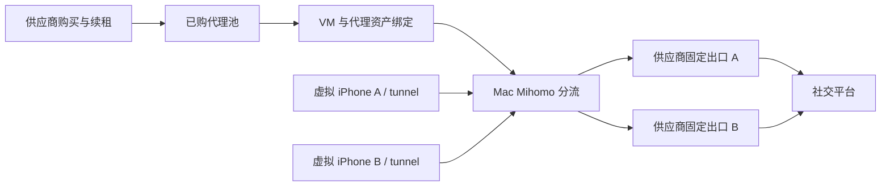

# 虚拟机 IP 供应商、地址池与出口分配调研

> 2026-10-21 需求更新：用户明确每个 IP 约用五分钟、位置尽量精确、偶尔随机重复可接受。**本报告的静态 ISP 优先推荐已由[短会话与地理定位新版方案](short_session_geo_proxy_strategy_20261021.md)替代。** 下文保留长期固定地址场景的调查和已实现手动入口记录，不再作为当前采购排序。

日期：2026-10-21。范围：供应商官网/API 文档调研、现有源码与历史验收记录核对，以及用户补充要求的手动录入 MVP 实现；没有注册账户、付款、调用收费 API、切换现有代理或启动虚拟机。供应商价格为美元公开价，税费、支付费用、地区库存和最终结算价需另核实；标“起”的价格不能当作少量购买报价。

用户补充：第一版先手动切换 IP，跑通流程；规模按 **5 台 VM** 估算，预算未设定。首期不实现自动采购/充值/续租，也不为估算创建五台镜像。以下供应商对比保留长期方向，实施入口收敛为手动录入已购代理、保存到当前订阅、选择实例出口、应用并从 guest 检测。

## 1. 建议与适用边界

建议将产品能力从“选择 VPN 节点”扩展为“选择已购代理出口”。对于同一台虚拟机持续登录社交 App，优先评估**独享静态 ISP 代理**；临时地域测试用按量住宅代理；机房代理可用于低成本连通性测试。短期需求首先比较 IPRoyal 的日租、Proxy-Seller 的周租，月租比较 Decodo 的小数量独享 ISP 套餐。供应商详细核验见 [供应商分报告](../ip_supplier_comparison_20261021.md)。这些是试点候选，不是已经实测 Instagram 可用的供应商排名。

这里通常购买的是一段时间内的代理服务使用权，不是取得公网 IP 的所有权。供应商分配代理后，可以在本地池中选择具体资产绑定 VM；不能假设下单前就能任意挑选某个公网数字地址。供应商入口域名/IP、连接端口、认证参数与最终公网出口 IP 需要分别记录。例如 Oxylabs 的自助独享 ISP 用固定端口映射已分配 IP，轮换端口则会在池中随机选出口。[Oxylabs 接入说明](https://developers.oxylabs.io/help-center/getting-started/start-using-dedicated-isp-proxies)

固定 ISP 也可能物理托管在机房；“ISP/静态住宅”不保证目标平台一定判定为家庭设备。静态、独享、地区、流量和租期是独立属性，不能只凭产品名称推断。动态住宅的 sticky/session 仅是临时保持出口，不能作为几天后仍可取回同一地址的资产。[Oxylabs 产品定义与会话说明](https://oxylabs.io/pricing/dedicated-isp-proxies)

## 2. 供应商比较

以下价格与结论分开看：公开套餐用于估算，实时 quote/结算页才是购买依据。最低充值、最低套餐、单位消耗价格和实际扣款不是同一件事。

| 供应商 / 产品 | 短期与公开价格 | 对本需求的判断 | 官方依据 |
| --- | --- | --- | --- |
| **IPRoyal 独享 ISP** | 1 IP 起；24 小时 `$1.80/IP 起`；30 天 `$2.70/IP 起` | **日租试点首选候选**；支持固定资产及订单 API。小量实时价待 quote；100GB/IP/30天池额度，独享超额降速 | [价格](https://iproyal.com/other-proxies/dedicated-residential-isp-proxies/)、[1 IP FAQ](https://help.iproyal.com/en/articles/7222122-can-i-buy-one-isp-proxy)、[FUP](https://help.iproyal.com/en/articles/12094903-what-is-the-fair-usage-policy) |
| **Decodo Dedicated ISP** | 3 IP `$9.99/月 + VAT`；10 IP `$29/月 + VAT` | **少量月租对照**；要选 Dedicated。先核对 IG 视频目标限制；公开 API 未证实可下单 | [完整套餐](https://decodo.com/proxies/isp-proxies/pricing)、[限制](https://help.decodo.com/docs/dedicated-isp-proxy-restricted-targets) |
| **Proxy-Seller 独享 ISP** | 1 IP、1 周起；月价 `$3/IP 起`，周价需实时计算 | **周租与购买 API 候选**；不能把千 IP 批量起价当小量实付 | [租期](https://proxy-seller.com/isp/)、[价格条件](https://proxy-seller.com/blog/what-are-isp-proxies-meaning-features-and-use-cases/)、[购买 API](https://docs.proxy-seller.com/api-v2/order-actions) |
| **Webshare Dedicated Static ISP** | 最小公开档 20 IP `$42/月` | 两机利用率低；静态池扩容候选。共享的 20 IP/$6 档不能替代独享；不支持 UDP | [独享套餐](https://www.webshare.io/dedicated-static-residential-proxy)、[UDP](https://help.webshare.io/en/articles/8375290-do-you-support-udp-proxy-connections) |
| **DataImpulse 动态住宅** | `$1/GB`；首购 `$5/5GB`，之后同类型最低 `$50/50GB`，流量不过期 | **短时动态测试辅助池**；粘性 1–120 分钟，不满足几天固定 IP；精细地区筛选可能倍扣流量 | [价格](https://dataimpulse.com/residential-proxies/)、[最低付款](https://help.dataimpulse.com/en/articles/15930995-minimum-payment-and-plan-sizes-explained)、[会话](https://docs.dataimpulse.com/proxies/types-of-connections) |
| **Bright Data 独享 ISP** | 10 IP `$35/月`；共享 10 IP `$18/月`；ISP PAYG `$8/GB` | 成熟月租对照；本需求需先确认 AUP 与视频用途，不作首选 | [ISP 定价](https://brightdata.com/pricing/proxy-network/isp-proxies)、[AUP](https://brightdata.com/acceptable-use-policy) |
| **Oxylabs Dedicated ISP** | 当前页 Starter `$30/月`，独享 ISP `$3/IP` | 月租对照；同页最小数量有矛盾，不能按旧 5 IP/$16 缓存下单 | [当前定价](https://oxylabs.io/pricing/dedicated-isp-proxies) |

日租候选不一定是连续使用一周最便宜的选择。比如 IPRoyal 30 天的公开起价只比 24 小时高 `$0.90/IP`，但两者都需要实际小量报价；不能把每天重购当成可续保原 IP 的连续租约。

IPRoyal 与 Proxy-Seller 已有下单/续租接口文档；IPRoyal 的 ISP API 路径属于 reseller，需要确认账户权限。Decodo 本次只证实管理与状态接口。Webshare 有购买接口，但需要实际支付时明确要求 Dashboard/reCAPTCHA；余额足够才是另一种情况。DataImpulse 普通 API 与需审核的 reseller API 要区分。因此“一键采购所有供应商”不适合作为首期承诺，先实现官网购买后导入及一个已确认可用的供应商适配。[IPRoyal 订单](https://docs.iproyal.com/proxies/isp/api/orders)、[Proxy-Seller 下单](https://docs.proxy-seller.com/api-v2/order-actions)、[Decodo API 范围](https://decodo.com/faq/getting-started/public-api)、[Webshare 购买限制](https://apidocs.webshare.io/subscription/purchase_plan)、[DataImpulse reseller](https://help.dataimpulse.com/en/articles/15931714-reseller-api-managing-sub-users-and-traffic)

### Proxy-Seller：适合周租及后续程序化购买

- ISP 页面支持 1 IP 起、1 周/2 周/月等租期，供应商声明租期内单客户独享，支持 HTTP(S)/SOCKS5；当前动态计算器抓取显示 `$0`，这是未加载报价，不能作为免费价格。`$0.98/IP` 广告起价也不能直接用于 2 台 VM 预算。官方文章把该低价关联到 1,000 IP/周的批量档，另列 ISP 月价 `$3/IP 起`。[产品与租期](https://proxy-seller.com/isp/)、[官方价格适用说明](https://proxy-seller.com/blog/what-are-isp-proxies-meaning-features-and-use-cases/)
- API 链路明确：`reference/list/isp` 查国家/租期/目标 → `order/calc` 无扣款询价 → `order/make` 从余额扣款并交付 → `proxy/list` 拉清单 → `prolong/calc` / `prolong/make` 续租。API 可用不代表已获得自动充值/付款授权。[下单流程](https://docs.proxy-seller.com/api-v2/order-actions)、[清单与续租](https://docs.proxy-seller.com/api-v2/actions-with-proxies-2)
- 集成细节：业务失败可能仍返回 HTTP 200，必须检查 `errors[]`；API key 在 URL 路径，日志要脱敏；续租后供应商标识可能改变，内部资产 ID 不能直接使用该可变标识。无需一开始做自动购买，第一版可导入已购清单。[接口错误模型](https://docs.proxy-seller.com/api-v2/order-actions)、[询价与标识变化](https://docs.proxy-seller.com/api-v2/order-actions/calculate-the-order)

### Bright Data：价格可核实，但不列为本次社交 App 首选

官网 ISP 月租公开档：共享 10 IP 为 `$18/月`，独享 10 IP 为 `$35/月`；ISP PAYG 是 `$8/GB`。前者不能冒充独享，后者不能当成购买固定 IP 的价格。官网起价 `$1.3/IP` 对应更大数量共享档，不能用于两机预算。[官方 ISP 定价](https://brightdata.com/pricing/proxy-network/isp-proxies)

其 AUP 对登录后非公开信息采集、流媒体域名等有明确限制；Instagram 营销页强调公开数据采集。因此不能把“有 Instagram 代理页面”当作通用 Instagram App 登录、看视频全部获准的证据。需要供应商确认具体用途与域名后再考虑，不在此报告中推断一切登录行为都被禁止。[AUP](https://brightdata.com/acceptable-use-policy)、[Instagram 产品用途](https://brightdata.com/solutions/instagram-proxy)

### Oxylabs：能力完整，当前公开报价存在迁移与最小数量矛盾

实时打开的 Dedicated ISP 定价页已是统一订阅：Starter `$30/月`、独享 ISP `$3/IP`，页面按订阅余额列数量；同页 FAQ 仍说至少 5 IP，与表格的较小数量不一致。搜索缓存还出现旧 `5 IP/$16/月`，不能按旧缓存报价采购。当前报告仅按 `$30/月` 作为入门订阅预算参考，实际最小独享 IP 数量、购买周期及余额扣费规则需后台确认。[当前 Dedicated ISP 定价](https://oxylabs.io/pricing/dedicated-isp-proxies)、[总定价](https://oxylabs.io/pricing)

普通 ISP 页面注明与最多 3 用户共享；独享 ISP 才是该需求的对照产品。独享支持 HTTP/HTTPS/SOCKS5、固定端口与 IP 列表，流量受 FUP 管理；有受限目标清单，未列某个域名不构成全部 App/CDN 可用保证。[共享 ISP 定义](https://oxylabs.io/pricing/isp-proxies)、[接入与清单](https://developers.oxylabs.io/help-center/getting-started/start-using-dedicated-isp-proxies)、[受限目标](https://developers.oxylabs.io/products/proxies/dedicated-isp-proxies/self-service/restricted-targets)

## 3. 如何选择短期产品

| 需求 | 优先产品 | 需要确认的条件 |
| --- | --- | --- |
| 只验证 1 天，要求测试期间地址固定 | 日租独享 ISP | 实际 1 IP 价格、24h 起算点、IG 登录与媒体目标是否支持 |
| 测试 3–7 天 | 周租独享 ISP，或直接买便宜月租 | 比较总付款；短租单价更高，月租可能反而便宜 |
| 一个账号连续多天/数周使用 | 月租独享 ISP | 续租保留原 IP、到期宽限、故障换 IP 和通知规则 |
| 几分钟到几小时地域检查，允许换 IP | 按量住宅 sticky session | 最大保持时间、节点离线行为、流量有效期、是否允许强制换地址 |
| 大量视频/长时间运行 | 按 IP 计费的静态方案 | FUP、限速与并发，不能只看“unlimited”广告 |
| 只要求低价出口、任务接受机房地址 | 独享 IPv4 机房代理或自有 VPS | 目标兼容性、维护费；不等同于 ISP 地址 |

小时级需要“持续固定、独享、指定地点”的 IP，不能用按量住宅的低 GB 单价直接满足。真正的移动 IP 也可能轮换或由运营商 NAT 共享；只有出现移动 ASN/通话等已验证需求再专项选型，本期不默认采购昂贵移动产品。

### 五机预算（并保留两机试点、十机对照）

| 需求 | 可用于比较的总额（USD） | 计算边界 |
| --- | --- | --- |
| 2 台固定出口，24 小时 | IPRoyal 起价下界 `$3.60` | `2×1.80`，不是已取得的 2 IP 实付报价 |
| 2 台固定出口，30 天 | IPRoyal 下界 `$5.40`；Decodo 3 IP 套餐 `$9.99+VAT`；Webshare 20 IP 套餐 `$42`；Bright Data 10 IP 独享套餐 `$35` | 套餐剩余资产可留作备用，不按单位价虚构 2 IP 套餐 |
| **5 台固定出口，24 小时** | **IPRoyal 起价下界 `$9`** | `5×1.80`，指定地区及小量实际报价待确认 |
| **5 台固定出口，30 天** | **IPRoyal 下界 `$13.50`；Decodo 10 IP 档 `$29+VAT`；Webshare 20 IP 档 `$42`；Bright Data 10 IP 独享档 `$35`** | Decodo 未列 5 IP 档；不假设可买两份 3 IP 套餐叠加。Proxy-Seller `$3/IP/月起` 仅能给 `$15` 下界，实际 5 IP/周或月以 quote 为准；Oxylabs 参考 `$30/月` 起但最小数量矛盾未解决 |
| 10 台固定出口，30 天 | IPRoyal 下界 `$27`；Decodo 10 IP `$29+VAT`；Webshare 20 IP `$42`；Bright Data 10 IP `$35` | 价格比较不证明当前运行路径方案可以直接隔离十机 |
| 全部 VM 合计 5GB，短时动态出口 | DataImpulse 首购 `$5`，后续需至少充值 `$50`；Decodo PAYG 理论用量价 `$20+VAT` | 实际预付款门槛另查；住宅轮换不是固定 IP 方案 |

这些算例分别依据 [IPRoyal 起价](https://iproyal.com/other-proxies/dedicated-residential-isp-proxies/)、[Decodo 独享套餐](https://decodo.com/proxies/isp-proxies/pricing)、[Webshare 独享套餐](https://www.webshare.io/dedicated-static-residential-proxy)、[Bright Data 独享套餐](https://brightdata.com/pricing/proxy-network/isp-proxies)、[DataImpulse 充值](https://dataimpulse.com/residential-proxies/)、[Decodo PAYG](https://help.decodo.com/docs/proxy-pay-as-you-go)。Decodo PAYG 消耗 90% 时可从钱包自动增购 1GB，试验前应明确关闭或限定；不能把理论流量费当充值上限。

总成本 = 租金/套餐费 + 计费流量及超额 + 必要的宿主传输费用 + 税/支付费用。视频用量未测量前不假定每台每月只消耗 1GB。IPRoyal 的营销“无限”与 FUP 需一起阅读；其独享超过池额度后降速，不能预算成无条件满速无限。[FUP](https://help.iproyal.com/en/articles/12094903-what-is-the-fair-usage-policy)

## 4. 与本机现有架构衔接

已核对当前源码和 2026-10-17 验收资料：实施前 Workstation 已有每实例节点选择、持久规则写入、Mihomo 重载、目标旧连接断开和 guest 出口检测，但只能选择现有 `/proxies` 中的节点。本轮新增手动录入能力见第 7 节；**外部供应商购买、库存同步、独立资产池和到期管理尚未实现**。[使用说明](../../Documents/Guides/workstation-network.md)、[既有实测](workstation_proxy_20261017.md)、[现有服务](../../VPhoneWorkstation/Sources/VPhoneWSCore/Proxy/ClashProxyService.swift)

这是拟采用的结构：guest 继续使用已有 tunnel，Mac 将对应 VM 的流量送到供应商 HTTP CONNECT/SOCKS5 入口。Mihomo 1.19.32 的官方实现已支持两类代理、账号密码和可选 TLS，SOCKS5 有 UDP ASSOCIATE；无需 guest 安装 VPN 或根证书。供应商必须提供通用代理协议，采集 API/浏览器 API 不能直接代替 App 的网络出口。[固定版本 HTTP 实现](https://github.com/MetaCubeX/mihomo/blob/v1.19.32/adapter/outbound/http.go)、[固定版本 SOCKS5 实现](https://github.com/MetaCubeX/mihomo/blob/v1.19.32/adapter/outbound/socks5.go)

若本机到供应商网关能直连，出站无需额外 VPN 节点；若不可达，可评估“现有宿主节点作传输 → 供应商代理作最终出口”。Mihomo 的 `dialer-proxy` 提供链式拨号能力，最终网站观察的是末端出口；链式方案会增加延迟及传输成本，UDP 必须沿整条链验证。这是基于官方能力的可行方案推断，本轮未在本机部署。[官方链式拨号说明](https://wiki.metacubex.one/en/config/proxies/dialer-proxy/)

当前隔离依据独立 `vphone-vm` 运行路径；代码明确拒绝同库内共用运行程序的实例。它适合当前已有两机，但不能承诺新增十台 VM 共用 runtime 也可独立分流。规模扩展前应评估每实例可识别入口/独立网络上下文，并落实在 CLI/Core 的既有网络边界；不要为满足路径规则给每台 VM 复制整套 runtime，更不能只改 VM 名称就宣称隔离成功。[现有隔离校验](../../VPhoneWorkstation/Sources/VPhoneWSCore/Proxy/ClashProxyService.swift)、[架构边界](../../Documents/Guides/architecture-boundaries.md)

## 5. 完整资产管理的后续扩展路线（不属于本轮实现）

1. **购买/导入**：选供应商、独享性、国家、数量、租期；展示实时总价和到期点。第一版可在官网购买，再导入已购 HTTP/SOCKS5 清单；接 API 的供应商可同步余额、库存和到期。购买 API 超时先查订单，不能盲目重试扣款。
2. **入池验证**：解析协议、入口、端口、认证；区分固定资产与动态会话。核对供应商分配 IP 与实测出口，记录地区/ASN/检测时间。认证错误、过期和不可达分别显示；无目标 App 实测的资产标“未验收”。
3. **分配**：虚拟机详情选一个可用资产，展示“独享/共享、静态/动态、预计到期、最近出口”；按内部资产 ID 绑定。默认一个固定出口只分配一台 VM；HTTP/SOCKS5 两种端口若对应同一公网 IP，不能算两个独立地址。
4. **应用**：预检目标 VM 绑定 runtime、tunnel、Clash 配置一致性及供应商可达性；写入由管理端拥有的节点配置和实例规则，保留其它订阅内容；核对持久化、生成配置、生效规则；只关闭该实例旧连接。
5. **验收**：目标 guest 发起探测，显示实际公网 IP；随后核对 Instagram App 实际域名连接、图片/视频加载。两机同时测得不同出口才算双机隔离通过，Mac 自己的出口测试不能替代。既有记录中 Instagram IPA 仍缺，之前 Facebook 分流验收不能冒充 Instagram App 验收。[guest 检测契约](../../Documents/Guides/workstation-network.md)、[原验收边界](../branch_workflow.md)
6. **续租/故障**：刷新到期、余额和流量；续租后重新同步映射并核对 IP；过期资产不再允许分配。固定社交会话不要静默换地址。断线时按该实例策略阻断并告警，而非回退宿主直连；这个阻断能力当前尚未实现，尤其宿主 TUN 整体退出时不能仅靠一个代理规则保证，实施时必须单独设计和验收。

只有在实际需要自动同步库存和续租时，再增加三个持久对象：供应商账户（类型、凭据引用）、代理资产（内部 ID、供应商订单/资产 ID、固定/动态、独享性、入口/端口、分配 IP、到期/流量）、VM 绑定（实例真实身份、资产 ID、期望配置、应用结果、最近测量）。届时凭据源考虑 Keychain；外部内核需要的运行配置文件按最小权限保存，不能宣称密码从不落盘。动态会话另记 session ID/TTL/最近出口，不能写成永久资产占有。本轮复用现有订阅文件和实例规则，没有增加这三类数据库或 Keychain 存储。

业务编排与供应商适配沿 `VPhoneWSCore/Proxy` 演进；View 只展示，公共网络规则留在既有 Core/CLI，供应商产品 ID 与账单字段不放进通用 VM manifest。先接一个真实供应商，再在第二个适配出现时抽取共性，不先做通用商城/计费平台。[项目维护边界](../../Documents/Guides/architecture-boundaries.md)

## 6. 首轮试点与验收标准

建议先用两台现有 VM、两条不同的固定独享 ISP 出口做 24 小时试点。首选短租候选为 IPRoyal；与 Decodo 小额月租比较最终报价，若明确只用一周则加 Proxy-Seller 实时报价。采购前确认目标地区库存、Instagram 原生 App 登录/图片/视频的可用范围、流量条款、续租保留 IP 及替换政策。这些确认针对具体用途，不需要因此建立额外通用审批系统。

验收至少覆盖：双机同时在线且公网 IP 不同；重启 guest/管理器后绑定保持；订阅重新生成后节点和规则仍在；单独换出口不影响另一台；认证失败、代理失联、过期、TUN 退出时不静默直连。DNS、UDP/QUIC、IPv6 分项记录：HTTP 代理不能因此宣称全协议覆盖，SOCKS5 支持也不等于供应商实际开放 UDP。不能代理的协议选择明确阻断或验证过的策略，不能无提示直连。HTTPS 的目标证书校验继续保留，不以关闭校验或安装中间人证书解决连接错误。

本轮能确认的是供应商公开条款、报价结构与接入可行性，不能确认本机到供应商的实时线路质量、具体分配 IP 的历史质量、所有 Instagram CDN 行为或账号结果。固定 IP 的作用是稳定和管理出口，不能保证社交平台账号不受限制。

## 7. 本轮实际实现与验证

按用户“先简单实现，手动切换”的补充要求，新增了实例详情中的“添加已购代理 IP”表单。用户输入名称、协议、入口、端口和可选认证，保存为当前 Clash 订阅的 `IP · 名称` 节点；再选择节点、点击既有“应用出口并检测”。支持 HTTP CONNECT、SOCKS5、可选代理入口 TLS 与 SOCKS5 UDP，无需在虚拟机安装 VPN。该入口复用既有规则与 guest 检测，不创建供应商账户、库存数据库、自动采购或续费任务。

持久化写入当前订阅绑定的 proxies 扩展及生成配置，保留已有字节与注释；文件在写入凭据前即以 0600 创建。错误信息不包含供应商密码。失败仅尝试恢复仍属于本次写入的文件，外部修改保留。新节点保存与实例出口切换是两个明确操作。

复核固定版本源码发现 Verge 在重新生成配置时会把扩展节点加入第一个 Selector 组；Mihomo 只恢复已缓存的选择。因此保存前将各 Selector（含 GLOBAL）的当前选择通过控制 API 写入缓存，重载后核对不变；显式关闭 `profile.store-selected` 时拒绝导入。该行为依据 [Verge 2.5.8 代理扩展实现](https://github.com/clash-verge-rev/clash-verge-rev/blob/v2.5.8/src-tauri/src/enhance/seq.rs) 和 [Mihomo 1.19.32 选择 API](https://github.com/MetaCubeX/mihomo/blob/v1.19.32/hub/route/proxies.go)。

验证记录：`VPHONE_TEST_MIHOMO='/Applications/Clash Verge.app/Contents/MacOS/verge-mihomo' ./scripts/dev.sh test gui`，83 项测试通过，含五个代理节点经真实 Mihomo 1.19.32 的 `-t` 配置校验；覆盖参数、特殊字符、YAML 保留、重名、保存、应用、失败回滚、外部编辑及策略组选择缓存。测试没有连接供应商，不能视为五台虚拟机或 Instagram App 实测。

`./scripts/dev.sh build gui` 构建成功，输出 `VPhoneWorkstation/.build/vphone-ws.app`；`git diff --check` 通过。构建仍报告未改动文件 `StreamingRunner.swift` 与 `TaskModel.swift` 的既有并发/捕获警告，本次新增文件没有构建警告。未重启运行中的 GUI，未做新表单的交互验收；重新打开构建产物后才会显示新入口。

当前限制：新增代理属于当前订阅；编辑/删除仍用 Clash Verge 代理扩展。没有供应商到期同步、IP 去重/独享保证、强制断线阻断、链式拨号配置入口或已购供应商线路验收。每实例仍须满足现有独立 runtime 路径与前置规则条件；五机是预算口径，不表示已创建或验证五机隔离。运行中的 Workstation 未重启，现有 VM 和真实 Clash 配置未改动。
